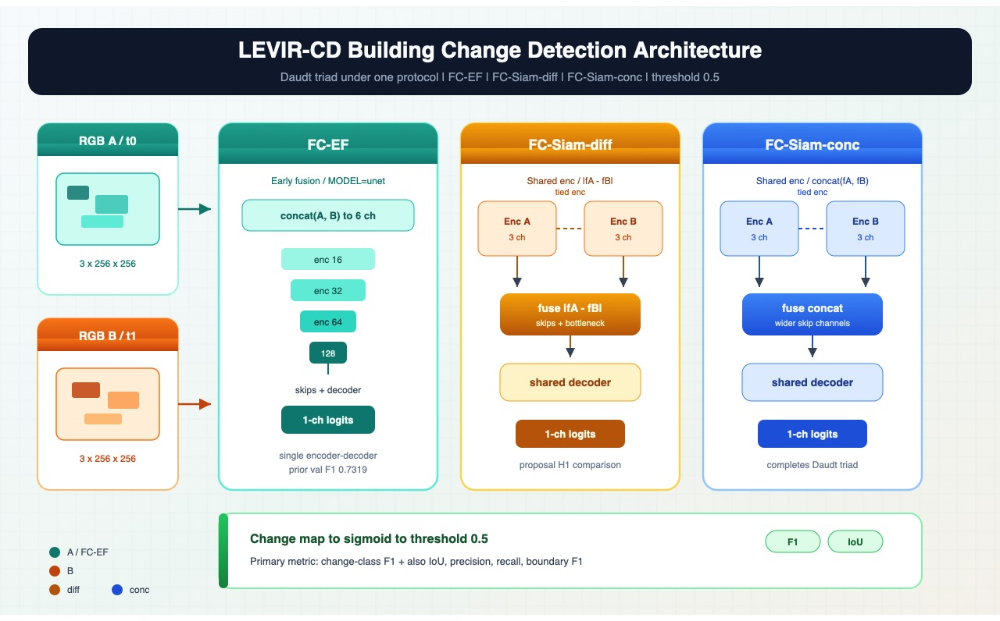

# Building Change Detection in Multi-Temporal Satellite Images

DATA 255 Deep Learning Vision term project, Fall 2026  
Team **BuildSafe Vision**: Sneha Singh, Ritika Mukesh Neema, Danish Waseem, Rajesh Paruchuri

This project studies whether deep learning can identify building construction and demolition by comparing satellite images of the same location taken at different times. The primary comparison is a six-channel U-Net versus a shared-encoder Siamese U-Net. Experiments evaluate segmentation quality, class imbalance, loss/augmentation ablations, and computational cost.

Project proposal: [`docs/Data255_ProjectProposal.pdf`](docs/Data255_ProjectProposal.pdf)

**Status:** Dataset audit + prior U-Net validation baseline are available. Shared training code, Siamese U-Net, ablation switches, reference absolute-difference baseline, and a **dataset-free smoke test** are in this repo. Full multi-seed / test-set results are not locked yet. Final report comes later.

## Research question

Does a Siamese U-Net improve building change detection over a standard U-Net, and how do loss functions and computational constraints affect detection accuracy?

## Architecture

Yes. The project has a **pipeline**, the full **Daudt et al. (2018) triad**, and LEVIR-CD metrics from **Chen & Shi (2020)**. Paper mapping: [`docs/RELATED_WORK.md`](docs/RELATED_WORK.md). Code: [`src/levir_cd/models.py`](src/levir_cd/models.py).

We **do not** reproduce STANet attention (explicitly out of proposal scope).



Vector version for slides/report: [`docs/architecture.svg`](docs/architecture.svg).

### End-to-end pipeline

```text
LEVIR pair (A, B, mask)
        │
        ▼
 notebook 01 audit ──► split_manifest.csv
        │
        ▼
 256×256 paired tiles  (+ optional synced flip/rot90)
        │
        ├──► Absolute RGB difference baseline (non-learned control)
        │
        └──► Learner (Daudt triad — choose one)
                 │
                 ├─ FC-EF         = 6-channel U-Net          (MODEL=unet)
                 ├─ FC-Siam-diff  = shared enc + |fA−fB|     (MODEL=siamese_diff)
                 └─ FC-Siam-conc  = shared enc + concat(fA,fB) (MODEL=siamese_conc)
                         │
                         ▼
              change logits → sigmoid → threshold 0.5
                         │
                         ▼
         change-class Precision / Recall / F1 (+ IoU)
         pooled + per-image summaries
         (+ params, train time, batch-1 latency)
```

### Model comparison (aligned with Daudt ICIP 2018)

| Paper name | `MODEL` | Idea |
| --- | --- | --- |
| **FC-EF** | `unet` | Early fusion: concat bi-temporal RGB → one U-Net |
| **FC-Siam-diff** | `siamese` / `siamese_diff` | Tied encoders; fuse with absolute difference |
| **FC-Siam-conc** | `siamese_conc` | Tied encoders; fuse by concatenating skip features |

Principal proposal comparison: **FC-EF vs FC-Siam-diff**. FC-Siam-conc is included so the published triad is complete under the same protocol.

```text
FC-EF:     [A|B] ──► single encoder–decoder U-Net ──► change map

FC-Siam:   A ──► SharedEnc ──┐
                             ├─ fuse (diff | conc) ──► decoder ──► change map
           B ──► SharedEnc ──┘
```

Width default: `base=16` → `16→32→64→128` bottleneck (smoke may use 8). Prior FC-EF val F1 **0.7319** (seed 1511).

### Training / evaluation details

| Item | Setting |
| --- | --- |
| Tile size | 256×256 non-overlapping (smoke may use 64) |
| Optimizer | Adam, lr `1e-3`, weight decay `1e-4` |
| Losses | `bce` or `bce_dice` (ablation; imbalance-aware) |
| Primary metric | change-class **F1** (Chen & Shi protocol) |
| Secondary | IoU, precision, recall, boundary F1, per-image F1, small-building misses |
| Diagnostic only | overall accuracy (not used to pick checkpoints) |
| Selection | best **validation F1** checkpoint |
| Decision threshold | fixed **0.5** (no test tuning) |
| Code | `src/levir_cd/{models,data,losses,metrics,train,baseline}.py` |

## Dataset

[LEVIR-CD](https://justchenhao.github.io/LEVIR/) provides 637 pairs of 1024 x 1024 RGB satellite images with binary building-change masks (Texas scenes).

| Split | Original pairs | Non-overlapping 256 x 256 paired tiles |
| --- | ---: | ---: |
| Train | 445 | 7,120 |
| Validation | 64 | 1,024 |
| Test | 128 | 2,048 |
| Total | 637 | 10,192 |

Use **train/val only** while developing. Freeze choices before a single test evaluation. This repository does not distribute the imagery.

## Where to smoke-test / run after coding

You do **not** need the LEVIR download for a coding smoke test.

| Mode | Command / notebook | Needs LEVIR? | Use for |
| --- | --- | --- | --- |
| **Smoke (recommended after code changes)** | `PYTHONPATH=src python scripts/run_smoke.py` | No (synthetic tiles) | Shapes, loss, 1-epoch train, checkpoint write |
| **Unit tests** | `PYTHONPATH=src python -m pytest -q` | No | CI-style checks on CPU |
| **Notebook smoke** | `notebooks/02_experiments.ipynb` with `RUN_MODE="smoke"` | No | Interactive debug |
| **1-epoch real data** | same notebook, `RUN_MODE="benchmark"` | Yes | Timing on Mac MPS / GPU lab |
| **Full experiment** | same notebook, `RUN_MODE="full"` | Yes | Real U-Net / Siamese / ablation runs |

On this cloud agent VM there is typically **CPU only** and **no LEVIR dataset**, so use smoke/tests here. Run `benchmark`/`full` on a machine that has the dataset (for example the team Mac with MPS or the university GPU lab).

## Prior U-Net validation baseline

Already reported from the teammate full run (validation only, seed 1511):

| Measure | U-Net validation result |
| --- | ---: |
| Best F1 (Dice) | **0.7319** |
| IoU | 0.5772 |
| Precision | 0.6912 |
| Recall | 0.7778 |
| Best epoch | 24 of 30 |
| Parameters | 483,169 |

Artifacts: [`results/unet_baseline/`](results/unet_baseline/).

## Repository layout

The folder structure is intentionally small. Raw LEVIR imagery and `.pt` checkpoints stay outside Git.

```text
.
├── README.md
├── pyproject.toml
├── requirements.txt
├── docs/
│   ├── Data255_ProjectProposal.pdf   # course proposal (PDF)
│   └── RELATED_WORK.md               # paper → code mapping (Daudt / LEVIR / U-Net)
├── report/
│   └── report.md                     # written report draft (fill at end)
├── results/
│   └── unet_baseline/                # validation F1, curves, and gallery
├── src/levir_cd/                     # models, data, losses, train, smoke
├── scripts/
│   ├── run_smoke.py
│   └── run_plan.py                  # full proposal matrix + comparison table
├── tests/                            # CPU checks for the models
├── notebooks/
│   ├── 01_dataset_audit.ipynb        # data QA + manifest
│   └── 02_experiments.ipynb          # U-Net / Siamese / ablations / smoke
```

| Folder | Role |
| --- | --- |
| `docs/` | Proposal PDF and other static course docs |
| `report/` | Written report (`report.md`) |
| `results/` | F1 scores, plots, and other run numbers |
| `src/` | Library code used by notebooks and CLI |
| `notebooks/` | Only two: audit + experiments |

Two notebooks only: **01 = audit**, **02 = all model experiments**.

## Local setup

```bash
python3 -m venv .venv
source .venv/bin/activate
python -m pip install --upgrade pip
python -m pip install -r requirements.txt
python -m pip install -e .
python -m ipykernel install --user --name levir-cd --display-name "Python (LEVIR-CD)"
```

`scripts/run_plan.py --mode full` looks for LEVIR-CD beside the repo. If it is not there, it downloads the official train, val, and test archives once (about 2.3 GB, academic use only) into `../datasets/levir-cd`. To use a copy you already have, set `LEVIR_DATA_ROOT`:

```text
datasets/levir-cd/{train.zip,val.zip,test/}
```

```bash
export LEVIR_PROJECT_ROOT="$PWD"
export LEVIR_DATA_ROOT="/path/to/levir-cd"
```

## What is done

Code and docs for the proposal are in the repo. The only measured LEVIR score so far is the validation U-Net baseline below. Siamese, loss, and augmentation numbers are not invented.

| Piece | State |
| --- | --- |
| Dataset audit notebook | Ready. Needs the local LEVIR files. |
| FC-EF, FC-Siam-diff, FC-Siam-conc | Coded in `src/levir_cd/models.py` |
| BCE and BCE+Dice, paired flips/rotations | Coded |
| Change-class F1, IoU, precision, recall, boundary F1 | Coded. F1 picks the checkpoint. |
| Small-building and false-alarm summary | `failure_summary.json` |
| Threshold sweep around 0.5 | Logged on real runs. Official threshold stays 0.5. |
| Absolute-difference baseline | `PYTHONPATH=src python scripts/run_baseline.py` (validation only; writes `results/absdiff_baseline/`) |
| Full matrix | `PYTHONPATH=src python scripts/run_plan.py --mode full` (builds `results/levir_audit/split_manifest.csv` from `LEVIR_DATA_ROOT` or `../datasets/levir-cd` first) |
| Comparison table | `PYTHONPATH=src python scripts/run_plan.py --aggregate-only` writes `results/comparison_table.md` |
| Locked test (once, after freeze) | `PYTHONPATH=src python scripts/run_locked_test.py --checkpoint …/best_model.pt --i-confirm-choices-are-frozen` |
| U-Net validation F1 0.7319, seed 1511 | Done. [`results/unet_baseline/`](results/unet_baseline/) |
| Three-seed Siamese comparison, ablations, locked test | Not run yet. Needs LEVIR on a Mac or GPU. |

## Experiment checklist

On a machine with the dataset:

```bash
PYTHONPATH=src python scripts/run_plan.py --mode full
PYTHONPATH=src python scripts/run_plan.py --aggregate-only
```

That runs FC-EF and FC-Siam-diff at seeds 1511, 42, and 123, one FC-Siam-conc run, the BCE versus BCE+Dice ablation, and the augmentation ablation. Then freeze the choices and evaluate the test set once. Details are in [`report/report.md`](report/report.md).

## University GPU lab (recommended for the full matrix)

Mac MPS is fine for smoke checks. The nine-run `full` matrix is much faster on a CUDA lab GPU. Do not invent scores on the laptop while waiting.

1. Clone / pull this repo on the lab machine and create an env:

```bash
git clone https://github.com/danwaseem/levir-change-detection.git
cd levir-change-detection
git pull
python3 -m venv .venv && source .venv/bin/activate
pip install -U pip
pip install torch --index-url https://download.pytorch.org/whl/cu124   # adjust CUDA tag to the lab
pip install -r requirements.txt
pip install -e .
```

2. Point at LEVIR-CD (copy zips from the Mac, or let the script download once):

```bash
export LEVIR_DATA_ROOT="/path/to/levir-cd"   # train.zip, val.zip, test.zip
# optional: export LEVIR_PROJECT_ROOT="$PWD"
```

3. Code check, then full matrix (leave the session overnight / use `tmux` or `screen`):

```bash
PYTHONPATH=src python scripts/run_smoke.py
PYTHONPATH=src python -m pytest -q
PYTHONPATH=src python scripts/run_plan.py --mode full
PYTHONPATH=src python scripts/run_baseline.py
PYTHONPATH=src python scripts/run_plan.py --aggregate-only
```

4. After validation winners are frozen, **one** locked test:

```bash
PYTHONPATH=src python scripts/run_locked_test.py \
  --checkpoint results/experiments/<best_run>/best_model.pt \
  --i-confirm-choices-are-frozen
```

5. Copy `results/experiments/`, `results/comparison_table.md`, `results/absdiff_baseline/`, and `results/locked_test/` back to the team Mac for the report.

## Credits

LEVIR-CD: Chen & Shi (2020). Academic use only. Team contributions follow the project proposal.