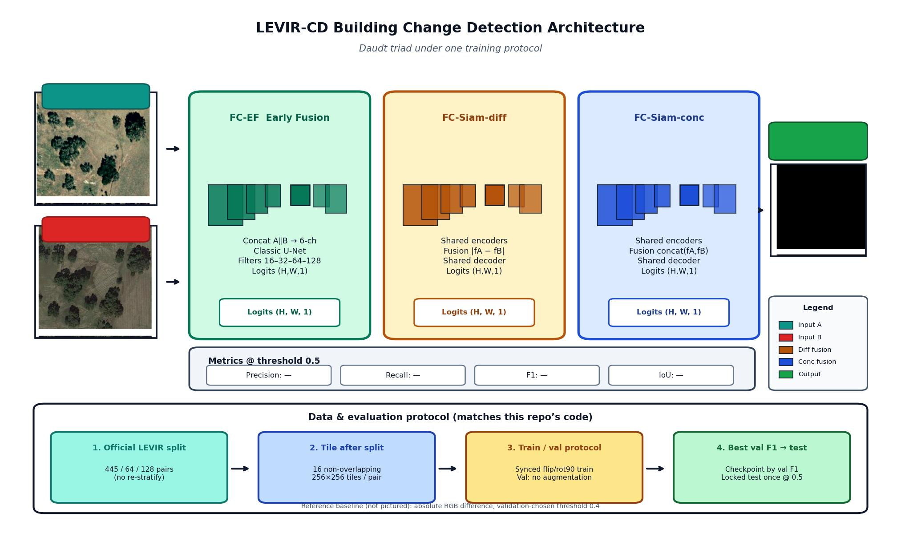

# Building Change Detection in Multi-Temporal Satellite Images

DATA 255 Deep Learning Vision, Fall 2026  
Team **BuildSafe Vision**: Sneha Singh, Ritika Mukesh Neema, Danish Waseem, Rajesh Paruchuri

Compares a six-channel U-Net (FC-EF) with shared-encoder Siamese U-Nets on [LEVIR-CD](https://justchenhao.github.io/LEVIR/) for building construction/demolition.

- Proposal: [`docs/Data255_ProjectProposal.pdf`](docs/Data255_ProjectProposal.pdf)  
- Final report (IEEE DOCX→PDF): [`report/report.pdf`](report/report.pdf) · [`report/DATA255_BuildSafeVision_IEEE.docx`](report/DATA255_BuildSafeVision_IEEE.docx) · builder [`report/build_ieee_report.py`](report/build_ieee_report.py)  
- Reproduction evidence: [`docs/REPRODUCTION.md`](docs/REPRODUCTION.md)  
- Presentation outline: [`docs/presentation/slides.md`](docs/presentation/slides.md)  
- Team work division: [`docs/TEAM_WORK_DIVISION.md`](docs/TEAM_WORK_DIVISION.md)  
- Week 3/4 Canvas uploads: [`docs/progress-report-week-3-4/`](docs/progress-report-week-3-4/) (dataset card + progress report PDFs)  
- Individual contribution statements: [`docs/individual-contribution/`](docs/individual-contribution/) ([Sneha](docs/individual-contribution/sneha_singh.md) · [Ritika](docs/individual-contribution/ritika_mukesh_neema.md) · [Danish](docs/individual-contribution/danish_waseem.md) · [Rajesh](docs/individual-contribution/rajesh_paruchuri.md))  
- Repo: https://github.com/danwaseem/levir-change-detection

---

## Project status — complete

| Deliverable | Status |
| --- | --- |
| Code (Daudt triad, losses, metrics, abs-diff, audits, tests) | Done |
| GPU 9-run matrix + comparison table | Done |
| Locked test (FC-EF BCE, seed 1511) | Done — **test F1 0.780** |
| Leakage audit (stem overlap = 0) | Done |
| Report write-up + figures | Done |
| Assistance disclosure | Done (Claude noted in report §11) |
| Presentation slides | Team / course schedule |

No further training or fine-tuning is required for submission. Numbers come only from `results/`.

---

## Headline results

| Method | Split | F1 | Notes |
| --- | --- | ---: | --- |
| Abs RGB difference | val | 0.129 | Non-learned reference |
| FC-EF (BCE+Dice, mean 3 seeds) | val | 0.718 | Principal comparison |
| FC-Siam-diff (BCE+Dice, mean 3 seeds) | val | 0.543 | H1 not supported |
| FC-Siam-conc (BCE+Dice, seed 1511) | val | 0.773 | Single seed |
| FC-EF BCE (locked) | val → **test** | 0.778 → **0.780** | Chosen after freeze |

**Hypotheses:** H1 (Siam-diff > FC-EF) and H2 (BCE+Dice > BCE) were **not supported** under this narrow (`base=16`) protocol. Absolute difference is far weaker than every learned model.

Figures: [`results/report_figures/`](results/report_figures/) · Gallery: [`results/experiments/full_unet_bce_aug_seed1511_tile256/validation_gallery.png`](results/experiments/full_unet_bce_aug_seed1511_tile256/validation_gallery.png)

---

## Architecture overview

We follow the Daudt et al. (2018) change-detection triad and score with change-class F1 (Chen & Shi, 2020). Code: [`src/levir_cd/models.py`](src/levir_cd/models.py). Paper map: [`docs/RELATED_WORK.md`](docs/RELATED_WORK.md). We do **not** reproduce STANet attention.

| Paper name | `MODEL` | What it does |
| --- | --- | --- |
| **FC-EF** | `unet` | Stack A and B as 6 channels → one U-Net |
| **FC-Siam-diff** | `siamese_diff` | Shared encoder; fuse with \|fA−fB\| |
| **FC-Siam-conc** | `siamese_conc` | Shared encoder; fuse by concatenating features |

All learned paths: logits → sigmoid → threshold **0.5** → change-class F1 / IoU / P / R. Width `base=16`. Checkpoint by validation F1.



```text
LEVIR pair (A, B, mask)
        │
        ▼
 256×256 tiles (+ optional synced flip/rot90)
        │
        ├── Absolute RGB difference (reference)
        └── FC-EF | FC-Siam-diff | FC-Siam-conc
                 │
                 ▼
        sigmoid → threshold 0.5 → change-class F1 / IoU / P / R
```

---

## Local setup

```bash
git clone https://github.com/danwaseem/levir-change-detection.git
cd levir-change-detection
git pull

python3 -m venv .venv
source .venv/bin/activate          # Windows: .venv\Scripts\activate
python -m pip install --upgrade pip
python -m pip install -r requirements.txt
python -m pip install -e .
```

**Dataset (LEVIR-CD, academic use only).** Not stored in Git.

```bash
export LEVIR_DATA_ROOT="/path/to/levir-cd"   # train/val/test with A/, B/, label/
```

**Quick check (no LEVIR needed):**

```bash
PYTHONPATH=src python scripts/run_smoke.py
PYTHONPATH=src python -m pytest -q
```

Do **not** commit smoke folders or `.pt` checkpoints.

---

## How to reproduce experiments

| Goal | Command | Needs LEVIR? |
| --- | --- | --- |
| Smoke (code only) | `PYTHONPATH=src python scripts/run_smoke.py` | No |
| Unit tests | `PYTHONPATH=src python -m pytest -q` | No |
| Abs-diff baseline (val) | `PYTHONPATH=src python scripts/run_baseline.py` | Yes |
| Full 9-run matrix | `PYTHONPATH=src python scripts/run_plan.py --mode full` | Yes (GPU recommended) |
| Build comparison table | `PYTHONPATH=src python scripts/run_plan.py --aggregate-only` | Summaries on disk |
| Locked test (once) | `PYTHONPATH=src python scripts/run_locked_test.py --checkpoint …/best_model.pt --i-confirm-choices-are-frozen` | Yes |

Full matrix already completed on the university GPU lab. Re-running is optional for reproduction only.

---

## Dataset

[LEVIR-CD](https://justchenhao.github.io/LEVIR/) — 637×1024² RGB pairs, Texas, building change masks. Academic use only.

| Split | Pairs | 256² tiles |
| --- | ---: | ---: |
| Train | 445 | 7,120 |
| Val | 64 | 1,024 |
| Test | 128 | 2,048 |

Stem overlap across splits: **0** ([`results/levir_audit/stem_overlap_report.json`](results/levir_audit/stem_overlap_report.json)). Imagery is not in Git.

---

## Repository layout

```text
.
├── README.md
├── configs/              # JSON configs for the nine reported GPU runs
├── docs/                 # proposal, related work, reproduction, slides, architecture
├── report/               # IEEE-style report.md + report.pdf
├── results/
│   ├── absdiff_baseline/
│   ├── levir_audit/      # stem overlap + manifest
│   ├── report_figures/   # loss / P-R / bar charts
│   ├── experiments/      # per-run summaries (+ locked gallery)
│   ├── locked_test/
│   └── comparison_table.md
├── src/levir_cd/
├── scripts/              # run_smoke, run_plan, run_baseline, run_locked_test
├── notebooks/
└── tests/
```

Cross-member artifact check: [`docs/REPRODUCTION.md`](docs/REPRODUCTION.md). Reported configs: [`configs/INDEX.md`](configs/INDEX.md).

---

## Credits

LEVIR-CD: Chen & Shi (2020). Academic use only.  
**Hard leads:** Sneha (data/protocol/abs-diff), Danish (GPU matrix/locked test/diagnosis).  
**Supporting:** Ritika (FC-EF config/progress packaging), Rajesh (tables/reproduction check).  
Details: [`docs/TEAM_WORK_DIVISION.md`](docs/TEAM_WORK_DIVISION.md).
