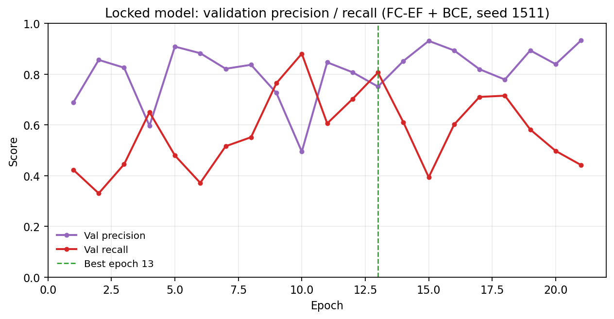

# Deep Learning for Building Change Detection in Multi-Temporal Satellite Imagery

**Sneha Singh, Ritika Mukesh Neema, Danish Waseem, and Rajesh Paruchuri**  
*BuildSafe Vision — DATA 255 Deep Learning Vision, Fall 2026*  
https://github.com/danwaseem/levir-change-detection

---

## Abstract

Building change detection marks construction or demolition between aligned satellite views. Pixel differencing is unreliable under illumination and vegetation shift. On LEVIR-CD we compare the Daudt triad—FC-EF, FC-Siam-diff, and FC-Siam-conc—under one PyTorch pipeline, with absolute RGB difference as a non-learned reference and controlled loss and augmentation ablations. Change pixels are rare (~4–5%). Primary metric is change-class F1 at threshold 0.5. Under matched BCE+Dice training, FC-EF mean validation F1 is **0.718** (3 seeds) versus **0.543** for FC-Siam-diff; FC-Siam-conc reaches **0.773** (1 seed). BCE-only FC-EF attains the best validation F1 (**0.778**) and a locked test F1 of **0.780**. Hypotheses favoring Siamese-diff and BCE+Dice are **not supported** at width `base=16`. Absolute difference remains far weaker (F1 **0.129**).

**Index Terms**—Change detection, remote sensing, U-Net, Siamese networks, LEVIR-CD, semantic segmentation.

---

## I. Introduction

Urban monitoring needs maps of building appearance and disappearance rather than every radiometric difference between dates. Shadows, plants, and sensor conditions create large non-building shifts. Fully convolutional networks cast the task as dense binary segmentation over a bi-temporal pair.

**Research question.** Under matched splits, tiles, and metrics, does a shared-encoder Siamese U-Net improve building-change F1 over six-channel early-fusion U-Net (FC-EF), and how do loss and paired augmentation affect accuracy and compute?

**Hypotheses.** (H1) FC-Siam-diff improves change-class F1/IoU over FC-EF by comparing dates in feature space, possibly at higher inference cost. (H2) BCE+Dice improves rare change-pixel detection relative to BCE alone.

**Success** means credible evidence for or against these claims under a fair protocol, including negative results. This is a course research prototype, not an operational system.

**Contributions.** (1) Reproducible PyTorch implementation of the Daudt triad on LEVIR-CD. (2) Nine-run GPU matrix with three-seed principal comparison and loss/augmentation ablations. (3) One locked test after freeze, with failure analysis.

---

## II. Related Work

Ronneberger *et al.* introduced U-Net encoder–decoder segmentation [1]. Daudt *et al.* compared FC-EF, FC-Siam-diff, and FC-Siam-conc for change detection [2]; we reimplement all three under one loop. Chen and Shi released LEVIR-CD and STANet and emphasized change-class F1 [3]; we use their data and metric style but do **not** reproduce STANet attention. Public FC-style test F1 near 0.81–0.86 often uses heavier schedules or ImageNet backbones [4], [5]—context only. Our networks use width `base=16` (~0.48–0.56M parameters) trained from scratch.

---

## III. Dataset and Evaluation Protocol

### A. Dataset

LEVIR-CD [3] provides 637 RGB pairs (\(1024\times1024\), ~0.5 m/pixel, Texas Google Earth) with binary building construction/demolition masks. Academic use; Google Earth terms apply (https://justchenhao.github.io/LEVIR/). Official split: train 445 / val 64 / test 128 pairs. Each pair is tiled into 16 non-overlapping \(256\times256\) patches **after** split assignment (7,120 / 1,024 / 2,048 tiles). Masks are binarized at intensity \(\ge 128\). Changed pixels are a small minority (~**4–5%**), motivating change-class F1 rather than overall accuracy.

### B. Leakage Audit

Filename-stem overlap across official splits is **0** (`results/levir_audit/stem_overlap_report.json`). This rules out trivial identity leakage but does not prove geographic independence; lat/long distance audits remain future work.

### C. Metrics and Test Policy

| Role | Metric |
| --- | --- |
| Primary (checkpoint) | Change-class F1 @ 0.5 |
| Secondary | IoU, precision, recall, boundary F1 |
| Not for selection | Overall pixel accuracy |

Learned models use fixed threshold **0.5**. Absolute difference uses a validation-chosen threshold (**0.4**). Model selection uses validation only. Freeze date **2026-11-08**; test touched once; no retuning.

---

## IV. Methods

**Fig. 1.** Bi-temporal inputs \(A\), \(B\) are tiled to \(256\times256\). Absolute RGB difference is the reference. Learned models: FC-EF, FC-Siam-diff, FC-Siam-conc; outputs scored at threshold 0.5.

**Reference baseline.** Mean absolute RGB difference \(|A-B|\) with validation F1-selected threshold (`scripts/run_baseline.py`).

**Strong baseline (FC-EF).** Concatenate \(A\|B\) (6 channels) into a U-Net \(16\rightarrow32\rightarrow64\rightarrow128\) (~483k parameters).

**Team investigation.** Shared-weight encoders on \(A\) and \(B\): FC-Siam-diff fuses with \(|f_A-f_B|\) (~483k); FC-Siam-conc concatenates features (~564k).

**Training.** Adam (\(10^{-3}\), weight decay \(10^{-4}\)), batch 4, up to 30 epochs with early stopping; checkpoint by validation F1. Losses: BCE vs BCE+Dice. Augmentation: synchronized flips and \(90^\circ\) rotations on \(A\), \(B\), and the mask. Seeds for the principal comparison: 1511, 42, 123. Full matrix on university CUDA GPU; Mac MPS for smoke/feasibility only.

---

## V. Experimental Setup

Nine full runs (`scripts/run_plan.py --mode full`):

| Role | Model | Loss | Aug. | Seeds |
| --- | --- | --- | --- | ---: |
| Principal | FC-EF | BCE+Dice | on | 3 |
| Principal | FC-Siam-diff | BCE+Dice | on | 3 |
| Triad | FC-Siam-conc | BCE+Dice | on | 1 |
| Loss ablation | FC-EF | BCE | on | 1 |
| Aug. ablation | FC-EF | BCE+Dice | off | 1 |

Held fixed for the principal comparison: splits, tile size, Adam settings, epoch budget, evaluation code, threshold 0.5. Configs: `configs/`. Protocol: Train → Validate → Diagnose → Improve → Freeze.

**Latency protocol.** After training, batch-1 inference uses 3 warm-up forwards, then 10 timed forwards with CUDA/MPS synchronization (`src/levir_cd/train.py`); preprocessing/data transfer outside the timed window are not included in the reported milliseconds.

---

## VI. Results

### A. Reference and Overview

Absolute RGB difference reaches validation F1 **0.129** (IoU 0.069). An early Mac feasibility FC-EF run reached 0.732 and is not part of the locked comparison.

**Fig. 2.** Validation change-class F1: reference, principal means, triad completion, and locked FC-EF+BCE (0.778).

### B. Principal Comparison (BCE+Dice, Augmentation On)

| Model | Seed | Val F1 | IoU | P | R | Lat. (s) |
| --- | ---: | ---: | ---: | ---: | ---: | ---: |
| FC-EF | 1511 | 0.702 | 0.541 | 0.734 | 0.673 | 0.0015 |
| FC-EF | 42 | 0.727 | 0.571 | 0.707 | 0.749 | 0.0014 |
| FC-EF | 123 | 0.726 | 0.570 | 0.753 | 0.701 | 0.0014 |
| FC-Siam-diff | 1511 | 0.503 | 0.336 | 0.674 | 0.402 | 0.0021 |
| FC-Siam-diff | 42 | 0.606 | 0.435 | 0.608 | 0.604 | 0.0021 |
| FC-Siam-diff | 123 | 0.521 | 0.352 | 0.941 | 0.360 | 0.0021 |
| FC-Siam-conc | 1511 | 0.773 | 0.630 | 0.836 | 0.719 | 0.0028 |

Mean±std val F1: FC-EF **0.718±0.011**; FC-Siam-diff **0.543±0.045**.

### C. Ablations (FC-EF, Seed 1511)

| Setting | Val F1 | IoU |
| --- | ---: | ---: |
| BCE+Dice, aug on | 0.702 | 0.541 |
| BCE only, aug on | **0.778** | 0.636 |
| BCE+Dice, aug off | 0.745 | 0.594 |

**Fig. 3.** FC-EF ablations (seed 1511). BCE-only is best; removing geometric aug also helps vs BCE+Dice+aug.

### D. Computational Trade-off

| Model | Params | Train | Ckpt | Batch-1 | Val F1 |
| --- | ---: | --- | --- | ---: | ---: |
| FC-EF (BCE, 1511) | 483k | ~51 min | 5.6 MB | 0.0014 s | **0.778** |
| FC-Siam-diff (1511) | 483k | ~47 min | 5.6 MB | 0.0021 s | 0.503 |
| FC-Siam-conc (1511) | 564k | ~48 min | 6.5 MB | 0.0028 s | 0.773 |

**Hardware/software.** Full matrix: university **CUDA** GPU lab (container workdir `/app/dl` in saved configs), batch 4, \(256\times256\) tiles; per-run wall times ~47–51 min in `summary.json`. Smoke/feasibility: Apple Silicon. Artifact verification host (2026-11-18): Darwin arm64, Python 3.13.5, **PyTorch 2.10.0**, CUDA unavailable locally (`results/environment.json`). Lab GPU SKU / CUDA toolkit build were not retained in committed summaries (checkpoints gitignored); timings and F1 scores remain those recorded on the lab runs.

FC-EF is Pareto-strong here: highest F1 among seed-1511 rows above and lowest latency.

### E. Locked Test

Selected setup: FC-EF + BCE + aug, seed 1511 (best validation F1 0.778 at epoch 13). **Test F1 / IoU / P / R = 0.780 / 0.639 / 0.770 / 0.790**; boundary F1 0.356. No retuning after test. Test closely matches validation, supporting a stable freeze.

---

## VII. Error Analysis, Limitations, and Responsible Use

**Fig. 4.** Locked FC-EF+BCE validation examples (before, after, GT, prediction @ 0.5). Large new buildings are often recovered; small structures and boundaries remain weak.

Locked-test failure summary (small change \(\le 256\) labeled pixels): empty tiles 1,113/2,048; missed small-change tiles 56/61 (mean recall 0.083 vs 0.702 on large change); 212 false alarms on empty tiles. Pooled test F1 is 0.780 while mean per-tile F1 is 0.297—expected under heavy empty/tiny-change tiles.

**Hypothesis outcomes.** H1 not supported for FC-Siam-diff (0.543 vs 0.718). FC-Siam-conc remains competitive on one seed (0.773), so the negative finding targets **difference fusion at this capacity**, not all Siamese designs. H2 not supported: BCE (0.778) beats BCE+Dice (0.702) on the ablation seed.

**Limitations.** (1) `base=16` limits peak F1 vs heavier public setups. (2) Stem overlap is only a partial geo-leakage check. (3) Single seed for FC-Siam-conc and ablations. (4) Texas Google Earth only. (5) Persistent small-object misses.

**Responsible use.** LEVIR-CD is for academic research under Google Earth terms. We make **no** medical, safety-critical, surveillance, or operational deployment claims. Geographic coverage is Texas-centric; performance may not transfer to other sensors or regions. Models can miss small buildings and false-alarm on empty tiles—unsuitable for automated decision-making without human review.

---

## VIII. Conclusion

Under a matched LEVIR-CD protocol, learned models dominate absolute difference (0.129 vs ~0.70–0.78 F1). FC-EF outperforms FC-Siam-diff; BCE outperforms BCE+Dice in our ablation; the frozen FC-EF+BCE model reaches **test F1 0.780**. The research question is answered with credible, partly negative evidence rather than a forced positive claim.

---

## Acknowledgment and Contributions

| Member | Responsibility |
| --- | --- |
| Sneha Singh | Dataset integrity, stem-overlap audit, abs-diff baseline |
| Ritika Mukesh Neema | FC-EF path, paired augmentation, seed runs |
| Danish Waseem | Siamese models, loss comparison, GPU matrix, error analysis |
| Rajesh Paruchuri | Metrics, timing, summaries, reproduction checks |

Reproduction evidence: `docs/REPRODUCTION.md`. Configs: `configs/`.

### Assistance Disclosure

Claude was used only to clarify difficult wording around ablation interpretation and hypothesis framing under conflicting seed/architecture outcomes. Experimental design, training, metrics, figures, and claims were produced and verified by the team against `results/`.

---

## References

[1] O. Ronneberger, P. Fischer, and T. Brox, “U-Net: Convolutional networks for biomedical image segmentation,” in *MICCAI*, 2015, pp. 234–241.

[2] R. C. Daudt, B. Le Saux, and A. Boulch, “Fully convolutional Siamese networks for change detection,” in *IEEE ICIP*, 2018, pp. 4063–4067.

[3] H. Chen and Z. Shi, “A spatial-temporal attention-based method and a new dataset for remote sensing image change detection,” *Remote Sensing*, vol. 12, no. 10, art. 1662, 2020.

[4] Open-CD LEVIR-CD benchmark tables (context only). https://github.com/likyoo/open-cd

[5] I. Corley *et al.*, “A change detection reality check,” arXiv:2402.06994, 2024 (context only).

---

## Appendix A. Extra Figures and Artifact Index

**Fig. A1.** Locked FC-EF+BCE train/val loss and validation F1/IoU (best epoch 13).

**Fig. A2.** Validation precision/recall for the locked run.

**Fig. A3.** Seed variability for the principal BCE+Dice comparison.

**Fig. A4.** Validation F1 trajectories at seed 1511.

| Artifact | Path |
| --- | --- |
| Proposal | `docs/Data255_ProjectProposal.pdf` |
| Related work notes | `docs/RELATED_WORK.md` |
| Reproduction evidence | `docs/REPRODUCTION.md` |
| Configs (9 runs) | `configs/` |
| Split manifest | `results/levir_audit/split_manifest.csv` |
| Stem-overlap report | `results/levir_audit/stem_overlap_report.json` |
| Comparison table | `results/comparison_table.md` |
| Locked test | `results/locked_test/full_unet_bce_aug_seed1511_tile256/` |
| Final PDF | `report/report.pdf` |
