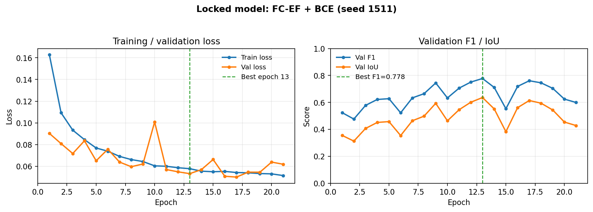
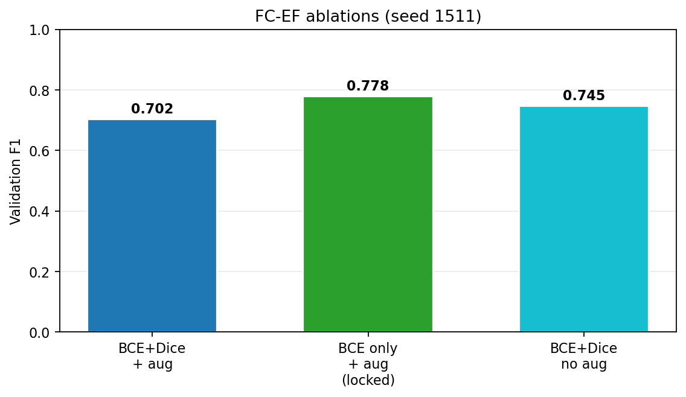
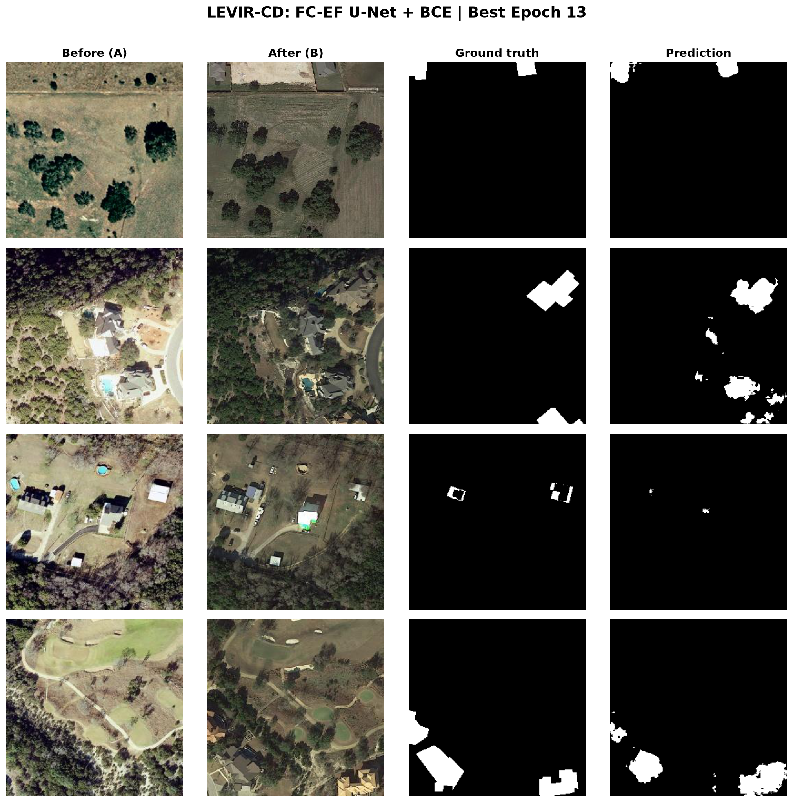

# Deep Learning for Building Change Detection in Multi-Temporal Satellite Imagery

**DATA 255 — Deep Learning Vision, Fall 2026**  
**Team:** BuildSafe Vision — Sneha Singh, Ritika Mukesh Neema, Danish Waseem, Rajesh Paruchuri  
**Repository:** https://github.com/danwaseem/levir-change-detection  

All reported scores are taken from finished runs under `results/`. No metrics were invented or back-filled after looking at the locked test set.

---

## Abstract

Building change detection asks whether a model can mark construction or demolition between two aligned satellite views of the same place. Pixel-wise image difference is unreliable because illumination, vegetation, and acquisition conditions also change. We study this problem on LEVIR-CD as binary semantic segmentation and compare the Daudt et al. (2018) triad—FC-EF, FC-Siam-diff, and FC-Siam-conc—under one data pipeline, loss family, and evaluation protocol. Absolute RGB difference is the non-learned reference. Controlled ablations vary loss (BCE vs BCE+Dice) and paired geometric augmentation.

On validation, absolute difference reaches change-class F1 **0.129**. Under matched BCE+Dice training, FC-EF obtains mean F1 **0.718** across three seeds, while FC-Siam-diff obtains **0.543**. FC-Siam-conc reaches **0.773** on a single seed. A BCE-only FC-EF run achieves the best validation F1 (**0.778**) and is frozen for one locked test evaluation (**test F1 0.780**). The results answer the research question with mixed outcomes: early fusion is stronger than difference-based Siamese fusion at our model capacity, and BCE+Dice does not dominate BCE. We do not claim STANet or published Open-CD leaderboard numbers as our own.

---

## 1. Introduction

Urban monitoring often needs building construction and demolition maps rather than every radiometric difference between two dates. Shadows, plants, and sensor conditions create large appearance shifts that are not building change. Fully convolutional networks treat the task as dense binary segmentation over a bi-temporal pair.

**Research question.** Under matched splits, tiles, and metrics, does a shared-encoder Siamese U-Net improve building-change F1 over a six-channel early-fusion U-Net (FC-EF), and how do loss choice and paired augmentation affect accuracy and compute?

**Hypotheses.**

- **H1.** FC-Siam-diff improves change-class F1 / IoU over FC-EF by comparing dates in feature space, possibly at higher inference cost.
- **H2.** BCE+Dice improves detection of rare change pixels relative to BCE alone.

Success is defined as producing credible evidence for or against these claims under a fair protocol, including negative or mixed results. This report describes a course research prototype, not an operational monitoring system.

**Contributions.**

1. A reproducible PyTorch pipeline for the Daudt triad on LEVIR-CD with shared dataloaders, metrics, and checkpointing.
2. A nine-run GPU experiment matrix with three-seed comparison of FC-EF vs FC-Siam-diff, plus loss and augmentation ablations.
3. One locked test evaluation after freezing the best validation setup, with qualitative and failure analysis.

---

## 2. Related work

We build on three primary sources; longer mapping notes are in [`docs/RELATED_WORK.md`](../docs/RELATED_WORK.md).

1. **Ronneberger et al. (2015)** introduced U-Net encoder–decoder segmentation with skip connections [1]. Our FC-EF model is a compact U-Net on a six-channel stacked pair.

2. **Daudt et al. (2018)** compared FC-EF, FC-Siam-diff, and FC-Siam-conc for change detection [2]. We reimplement all three under one training loop. The principal comparison follows the proposal (FC-EF vs FC-Siam-diff); FC-Siam-conc completes the triad.

3. **Chen and Shi (2020)** released LEVIR-CD and STANet and emphasized change-class precision, recall, and F1 [3]. We use their dataset and metric style. We do **not** reproduce STANet attention or batch-balanced contrastive loss; that was out of scope.

Public tables often report FC-style test F1 near 0.81–0.86 with heavier schedules or ImageNet backbones [4,5]. Those figures are context only. Our networks use width `base=16` (~0.48–0.56M parameters) and are trained from scratch.

---

## 3. Dataset and evaluation protocol

### 3.1 Dataset

| Item | Detail |
| --- | --- |
| Dataset | LEVIR-CD [3] |
| Source | https://justchenhao.github.io/LEVIR/ |
| Content | 637 RGB pairs, \(1024\times1024\), ~0.5 m/pixel, Texas Google Earth scenes |
| Labels | Binary building construction / demolition masks |
| License / use | Academic use; Google Earth terms apply |

We keep the official pair split and tile each image into 16 non-overlapping \(256\times256\) patches **after** split assignment:

| Split | Pairs | Tiles |
| --- | ---: | ---: |
| Train | 445 | 7,120 |
| Validation | 64 | 1,024 |
| Test | 128 | 2,048 |

Masks are binarized at intensity \(\ge 128\). Training and model selection use train/validation only. The test set is touched once after freeze.

### 3.2 Leakage audit

Filename-stem overlap across splits (`results/levir_audit/stem_overlap_report.json`):

| Split pair | Shared stems |
| --- | ---: |
| train / val | 0 |
| train / test | 0 |
| val / test | 0 |

Zero stem overlap reduces one leakage path. It does **not** prove that nearby geographic scenes never correlate across splits; a lat/long distance audit remains future work.

### 3.3 Metrics and decision rule

| Role | Metric |
| --- | --- |
| Primary (checkpoint selection) | Change-class F1 @ threshold 0.5 |
| Secondary | IoU, precision, recall, boundary F1 |
| Diagnostics | Per-image summaries; small-change / empty-tile failure counts |
| Not used for selection | Overall pixel accuracy |

Learned models use a fixed threshold of **0.5**. Absolute-difference uses a validation-chosen threshold. No threshold or architecture choice is retuned on test.

---

## 4. Methods

### 4.1 Overview


**Figure 1.** System overview. Bi-temporal inputs \(A\) (earlier) and \(B\) (later) are tiled to \(256\times256\). Absolute RGB difference is the reference. Learned models are FC-EF, FC-Siam-diff, or FC-Siam-conc; each outputs a change map scored at threshold 0.5.

### 4.2 Reference baseline

Mean absolute RGB difference \(\lvert A-B\rvert\) with a validation F1-selected threshold (selected value **0.4**). Implementation: `scripts/run_baseline.py`.

### 4.3 Strong baseline: FC-EF

Concatenate \(A\) and \(B\) into a 6-channel tensor and apply a U-Net with channel width \(16\rightarrow32\rightarrow64\rightarrow128\) (~**483,169** parameters).

### 4.4 Team investigation: Siamese variants

Shared-weight encoders process \(A\) and \(B\) separately.

- **FC-Siam-diff:** fuse features with \(\lvert f_A-f_B\rvert\) (~**482,737** parameters).
- **FC-Siam-conc:** fuse by concatenation (~**563,889** parameters).

A shared decoder predicts the change logits.

### 4.5 Training protocol

| Setting | Value |
| --- | --- |
| Optimizer | Adam, learning rate \(1\times10^{-3}\), weight decay \(1\times10^{-4}\) |
| Batch size | 4 |
| Schedule | up to 30 epochs with early stopping; best **validation F1** checkpoint |
| Losses compared | BCE; BCE + Dice |
| Augmentation | Synchronized horizontal/vertical flips and \(90^\circ\) rotations on \(A\), \(B\), and the mask |
| Seeds (principal comparison) | 1511, 42, 123 |
| Framework | PyTorch; full matrix on university CUDA GPU |

---

## 5. Experimental design

Nine full runs (`scripts/run_plan.py --mode full`):

| Role | Model | Loss | Augmentation | Seeds |
| --- | --- | --- | --- | --- |
| Principal | FC-EF | BCE+Dice | on | 1511, 42, 123 |
| Principal | FC-Siam-diff | BCE+Dice | on | 1511, 42, 123 |
| Triad completion | FC-Siam-conc | BCE+Dice | on | 1511 |
| Loss ablation | FC-EF | BCE | on | 1511 |
| Augmentation ablation | FC-EF | BCE+Dice | off | 1511 |

Held constant across the principal comparison: official splits, \(256\times256\) tiles, Adam settings, epoch budget, evaluation code, and threshold 0.5. Mac MPS was used for smoke tests and early feasibility only; one epoch already took ~16 minutes locally, so the matrix was completed on GPU.

### 5.1 Methodology loop (lecture alignment)

We follow the course loop **Train → Validate → Diagnose → Improve → Freeze**:

| Stage | What we did |
| --- | --- |
| Train | Nine GPU runs under a shared dataloader / optimizer / epoch budget |
| Validate | Checkpoint by **validation change-class F1** only (not overall accuracy) |
| Diagnose | Learning curves, precision/recall trajectories, seed spread, failure summaries |
| Improve | Controlled ablations (loss, augmentation); keep other factors fixed |
| Freeze | 2026-11-08: lock FC-EF+BCE seed 1511; **one** test evaluation; no retuning |

---

## 6. Results

### 6.1 Reference baseline and summary view

| Method | Split | Seed | F1 | IoU | Precision | Recall | Params |
| --- | --- | ---: | ---: | ---: | ---: | ---: | ---: |
| Absolute RGB difference | val | — | 0.129 | 0.069 | 0.096 | 0.193 | 0 |
| FC-EF (early feasibility) | val | 1511 | 0.732 | 0.577 | 0.691 | 0.778 | 483,169 |


**Figure 2.** Validation change-class F1 across the reference baseline, principal means, triad completion, and locked setup. Learned models dominate absolute difference; locked FC-EF+BCE is best overall (0.778).

### 6.2 Locked-model training dynamics

The selected model is FC-EF + BCE (seed 1511). Training curves show clear learning: train loss falls smoothly, validation F1 peaks at epoch **13** (F1 **0.778**), and later epochs are unstable—so early stopping / best-checkpoint selection matters.



**Figure 3.** Locked FC-EF+BCE run: train/val loss (left) and validation F1/IoU (right). Best checkpoint = epoch 13.


**Figure 4.** Validation precision and recall over epochs for the locked model. Epoch 13 balances both (~0.75 precision, ~0.80 recall); later epochs trade one for the other.

**Bias / variance diagnosis (from these curves).** At the best epoch, train and validation losses are close (≈0.058 vs 0.053), so the run is **not underfitting**: the model fits the training signal and generalizes on validation. After epoch 13, validation F1 falls sharply (e.g. ≈0.55 by epoch 15) while train loss keeps decreasing to ≈0.051 by epoch 21—an **overfitting / instability** pattern. This is exactly why we keep the **best validation-F1 checkpoint**, not the last epoch.

### 6.3 Principal comparison (GPU, BCE+Dice, augmentation on)

| Model | Seed | Val F1 | IoU | Precision | Recall | Boundary F1 | Latency (s) |
| --- | ---: | ---: | ---: | ---: | ---: | ---: | ---: |
| FC-EF | 1511 | 0.702 | 0.541 | 0.734 | 0.673 | 0.311 | 0.0015 |
| FC-EF | 42 | 0.727 | 0.571 | 0.707 | 0.749 | 0.323 | 0.0014 |
| FC-EF | 123 | 0.726 | 0.570 | 0.753 | 0.701 | 0.328 | 0.0014 |
| FC-Siam-diff | 1511 | 0.503 | 0.336 | 0.674 | 0.402 | 0.211 | 0.0021 |
| FC-Siam-diff | 42 | 0.606 | 0.435 | 0.608 | 0.604 | 0.227 | 0.0021 |
| FC-Siam-diff | 123 | 0.521 | 0.352 | 0.941 | 0.360 | 0.219 | 0.0021 |
| FC-Siam-conc | 1511 | 0.773 | 0.630 | 0.836 | 0.719 | 0.352 | 0.0028 |

| Model | Mean Val F1 | Std. |
| --- | ---: | ---: |
| FC-EF | **0.718** | 0.011 |
| FC-Siam-diff | 0.543 | 0.045 |


**Figure 5.** Validation F1 trajectories at seed 1511. FC-EF+BCE rises fastest to the best peak; FC-Siam-diff stays lower; FC-Siam-conc is competitive under BCE+Dice.


**Figure 6.** Seed variability for the principal BCE+Dice comparison. FC-EF is higher and tighter (std 0.011) than FC-Siam-diff (std 0.045).

### 6.4 Ablations

| Setting | Val F1 | IoU |
| --- | ---: | ---: |
| FC-EF, BCE+Dice, aug on, seed 1511 | 0.702 | 0.541 |
| FC-EF, BCE only, aug on, seed 1511 | **0.778** | 0.636 |
| FC-EF, BCE+Dice, aug off, seed 1511 | 0.745 | 0.594 |



**Figure 7.** FC-EF ablations (seed 1511). BCE-only beats BCE+Dice; removing paired flips/rotations also helps relative to BCE+Dice+aug.

### 6.5 Computational trade-off

| Model | Params | Train time | Checkpoint | Batch-1 latency | Val F1 |
| --- | ---: | ---: | ---: | ---: | ---: |
| FC-EF (BCE, seed 1511) | 483,169 | ~51 min | ~5.6 MB | 0.0014 s | **0.778** |
| FC-Siam-diff (seed 1511) | 482,737 | ~47 min | ~5.6 MB | 0.0021 s | 0.503 |
| FC-Siam-conc (seed 1511) | 563,889 | ~48 min | ~6.5 MB | 0.0028 s | 0.773 |

**Quality–cost reading.** FC-EF is Pareto-strong here: highest F1 among the seed-1511 runs above and the **lowest** batch-1 latency. FC-Siam-diff uses similar parameter count but worse F1 and slower inference. FC-Siam-conc is competitive on F1 but costs ~2× the latency and more parameters. For this budget, early fusion wins on both accuracy and efficiency.

### 6.6 Qualitative results and failure modes



**Figure 8.** Validation examples from the locked FC-EF + BCE checkpoint (best epoch 13). Columns: before, after, ground truth, prediction @ 0.5. Larger new buildings are often recovered; boundaries are softer than labels, and small structures can be weak or missed.

Locked-test failure summary (tile change \(\le 256\) pixels = “small”):

| Pattern | Value |
| --- | ---: |
| Empty tiles (no labeled change) | 1,113 / 2,048 (54.3%) |
| Small-change tiles | 61 |
| Missed small-change tiles | 56 / 61 |
| Mean recall (small change) | 0.083 |
| Mean recall (large change) | 0.702 |
| False alarms on empty tiles | 212 |
| Low-precision change tiles | 167 |

**Tile-level vs pooled metrics.** Pooled test F1 is **0.780**, but the mean of per-tile F1 is only **0.297** (std 0.379), and **59.1%** of tiles have F1 = 0. That gap is expected: most tiles are empty or tiny-change cases where a single FP/FN collapses tile F1, while pooled F1 aggregates pixels globally. Diagnosis: the model is stronger on **large** building changes (recall 0.70) and weak on **small** ones (recall 0.08)—matching the gallery.

### 6.7 Locked test evaluation

| Item | Value |
| --- | --- |
| Freeze date | 2026-11-08 |
| Selected setup | FC-EF, BCE, augmentation on, seed 1511 |
| Selection criterion | Highest validation F1 among finished runs (0.778) |
| Test F1 / IoU / Precision / Recall | **0.780** / 0.639 / 0.770 / 0.790 |
| Test boundary F1 | 0.356 |
| Retuned after seeing test? | No |

Test F1 (0.780) closely matches validation F1 (0.778), which supports that the freeze did not overfit a brittle validation quirk.

---

## 7. Discussion

### 7.1 Hypothesis outcomes

- **H1 — not supported** for FC-Siam-diff. Mean validation F1 is **0.718** (FC-EF) vs **0.543** (FC-Siam-diff) under identical BCE+Dice training. Diff fusion is also slower. FC-Siam-conc (0.773, one seed) remains competitive with early fusion, so the negative finding is about **difference fusion at this capacity**, not a blanket rejection of Siamese designs.
- **H2 — not supported** on the seed-1511 ablation. BCE-only FC-EF (**0.778**) exceeds BCE+Dice (**0.702**). We therefore froze BCE for the locked test (**0.780**).

Absolute difference (F1 0.129) remains far below every learned model, confirming that the task needs more than pixel subtraction even when architecture hypotheses are mixed.

### 7.2 What the diagnostics imply

Putting curves and failures together: the locked model **learned** (large gap over abs-diff; train/val losses aligned at the best epoch), but **capacity and class imbalance** still show up as (i) late-epoch validation collapse if we kept training, (ii) near-misses on small buildings, and (iii) empty-tile false alarms. Improving those would need targeted sampling, wider encoders, or harder augmentations—not another uncontrolled hyperparameter sweep.

### 7.3 Relation to prior literature

Daudt et al. often found Siamese variants competitive or preferred under their settings [2]. Our narrower from-scratch U-Nets and shorter budget reverse that ranking for FC-Siam-diff. The gap to published LEVIR tables (~0.81–0.86) is expected given capacity and schedule differences [4,5].

### 7.4 Limitations

1. Model width `base=16` limits peak F1 relative to heavier public setups.
2. Stem overlap is only a partial geographic-leakage check.
3. FC-Siam-conc has a single seed.
4. LEVIR-CD covers Texas Google Earth imagery only.
5. Qualitative gallery and failure counts show persistent small-object misses and empty-tile false alarms.

---

## 8. Conclusion

We implemented a controlled LEVIR-CD study of the Daudt triad with a non-learned difference baseline, loss/augmentation ablations, three-seed principal comparison, and one locked test. Learned models substantially beat absolute difference (0.129 vs ~0.70–0.78 F1). Under matched training, FC-EF outperforms FC-Siam-diff; BCE outperforms BCE+Dice on our ablation; the frozen FC-EF+BCE model reaches **test F1 0.780**. These outcomes answer the research question with credible, partly negative evidence rather than a forced positive claim.

---

## 9. Contributions and reproducibility

| Member | Technical responsibility |
| --- | --- |
| Sneha Singh | Dataset integrity, stem-overlap audit, absolute-difference baseline |
| Ritika Mukesh Neema | FC-EF / U-Net path, paired augmentation, seed runs |
| Danish Waseem | Siamese models, loss comparison, GPU matrix, error / gallery analysis |
| Rajesh Paruchuri | Metrics, timing, summaries, reproduction checks |

**Smoke check (no dataset required):**

```bash
PYTHONPATH=src python scripts/run_smoke.py
PYTHONPATH=src python -m pytest -q
```

**Full matrix (LEVIR required; CUDA preferred):**

```bash
export LEVIR_DATA_ROOT=/path/to/levir-cd
PYTHONPATH=src python scripts/run_plan.py --mode full
PYTHONPATH=src python scripts/run_baseline.py
PYTHONPATH=src python scripts/run_plan.py --aggregate-only
```

Configs and metrics live in `results/experiments/*/config.json` and `summary.json`. Aggregate table: `results/comparison_table.md`. Locked test: `results/locked_test/full_unet_bce_aug_seed1511_tile256/`.

**Protocol / software box (locked run).**

| Item | Value |
| --- | --- |
| Framework | PyTorch (CUDA GPU lab for full matrix; Mac for smoke) |
| Model | FC-EF U-Net, `base=16`, ~483k parameters |
| Loss / aug / seed | BCE / paired flip+rot90 / 1511 |
| Optimizer | Adam, lr \(1\times10^{-3}\), weight decay \(1\times10^{-4}\), batch 4 |
| Selection | Best validation F1 @ threshold **0.5** (epoch 13) |
| Test policy | Touched once after freeze; no threshold retune |

---

## 10. Future work

1. Scale width / schedule under the same splits to separate capacity from architecture.
2. Lat/long geographic distance audits between train and evaluation tiles.
3. Repeat the protocol on WHU-CD or LEVIR-CD+.
4. Targeted sampling or losses for small buildings.
5. STANet-style attention as a separate study (out of scope here).

---

## 11. Assistance disclosure

Claude was used as an assistance tool for writing organization, report formatting, and clarifying technical wording. All research design, experiments, metrics, figures from training runs, and final claims were produced and verified by the team against repository artifacts under `results/`. No generative scores were invented.

---

## References

[1] O. Ronneberger, P. Fischer, and T. Brox, “U-Net: Convolutional Networks for Biomedical Image Segmentation,” in *MICCAI*, LNCS 9351, pp. 234–241, 2015. doi: 10.1007/978-3-319-24574-4_28.

[2] R. Caye Daudt, B. Le Saux, and A. Boulch, “Fully Convolutional Siamese Networks for Change Detection,” in *IEEE ICIP*, pp. 4063–4067, 2018. doi: 10.1109/ICIP.2018.8451652.

[3] H. Chen and Z. Shi, “A Spatial-Temporal Attention-Based Method and a New Dataset for Remote Sensing Image Change Detection,” *Remote Sensing*, vol. 12, no. 10, art. 1662, 2020. doi: 10.3390/rs12101662. https://justchenhao.github.io/LEVIR/

[4] Open-CD LEVIR-CD benchmark tables (context only). https://github.com/likyoo/open-cd

[5] I. Corley et al., “A Change Detection Reality Check,” arXiv:2402.06994, 2024 (context only).

---

## Appendix A. Artifact index

| Artifact | Path |
| --- | --- |
| Proposal | `docs/Data255_ProjectProposal.pdf` |
| Related-work notes | `docs/RELATED_WORK.md` |
| Architecture figure | `docs/architecture.jpg` |
| Split manifest | `results/levir_audit/split_manifest.csv` |
| Stem-overlap report | `results/levir_audit/stem_overlap_report.json` |
| Absolute-difference summary | `results/absdiff_baseline/summary.json` |
| Feasibility curves | `results/unet_baseline/` |
| GPU comparison table | `results/comparison_table.md` |
| Locked-model gallery | `results/experiments/full_unet_bce_aug_seed1511_tile256/validation_gallery.png` |
| Report figures (loss / P-R / bars) | `results/report_figures/` |
| Locked test | `results/locked_test/full_unet_bce_aug_seed1511_tile256/` |
