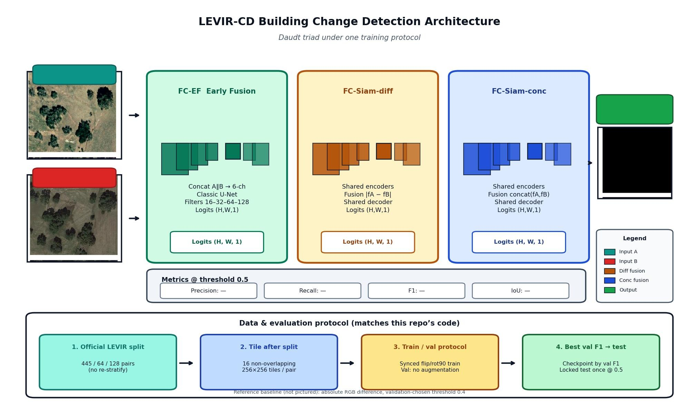
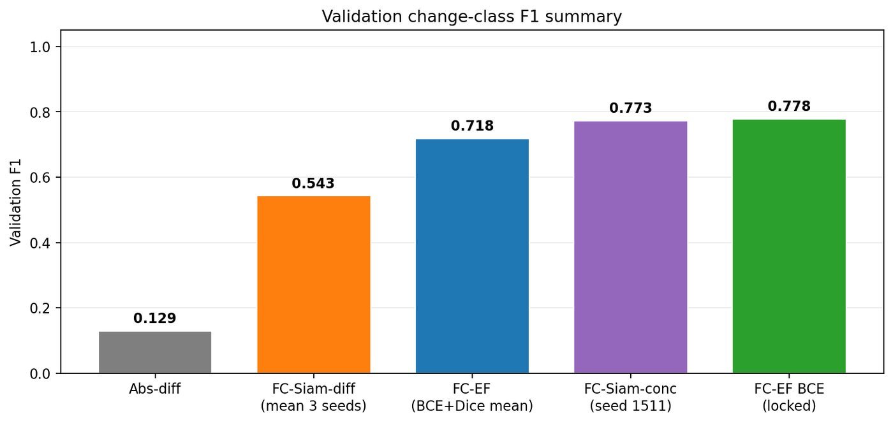
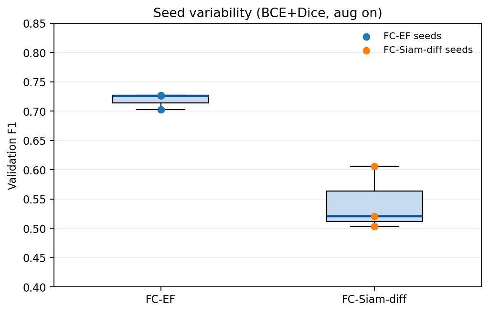
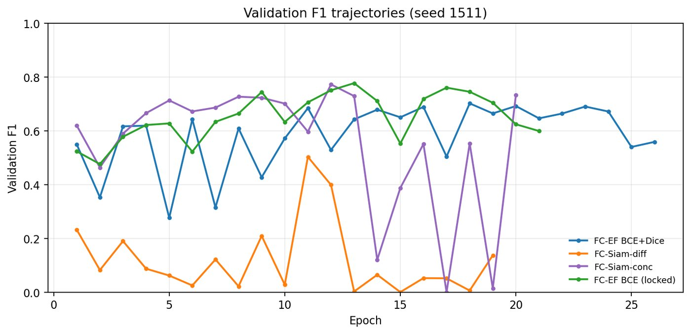
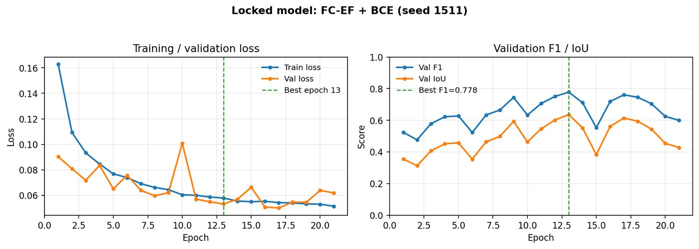
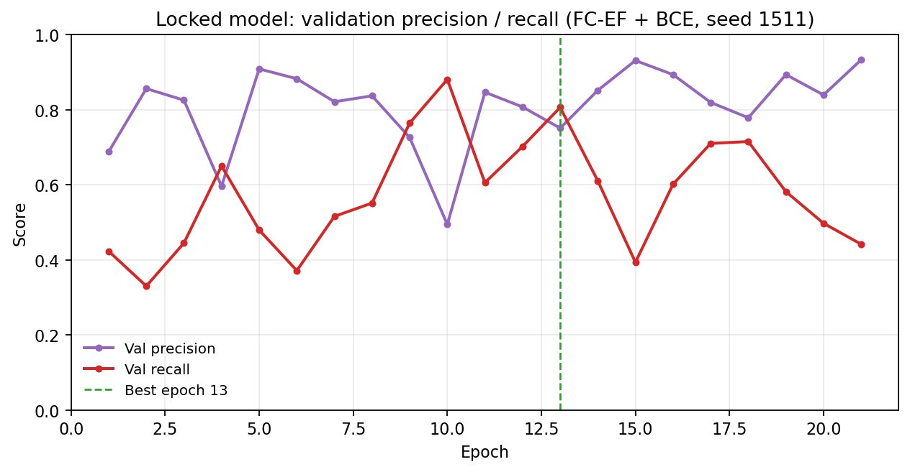
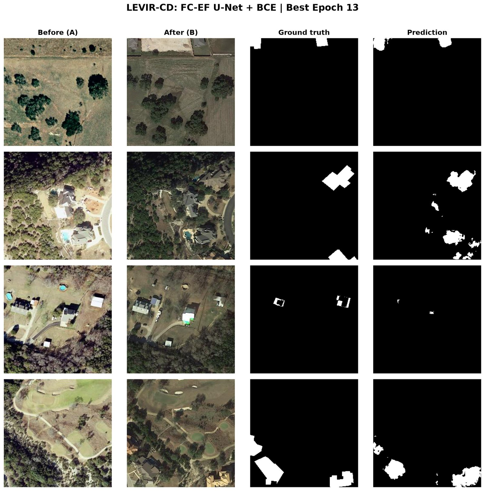

# Deep Learning for Building Change Detection in Multi-Temporal Satellite Imagery

Sneha Singh, Ritika Mukesh Neema, Danish Waseem, and Rajesh Paruchuri

Department of Applied Data Science, San Jose State University, San Jose, CA, USA

DATA 255 Deep Learning Vision, Fall 2026 · Team BuildSafe Vision

GitHub: https://github.com/danwaseem/levir-change-detection

## Abstract

Building change detection from bi-temporal satellite imagery is challenging because illumination, vegetation, and sensor variation can mimic structural change while true building construction or demolition occupies only a small fraction of pixels. This paper evaluates early-fusion and Siamese U-Net architectures for binary building-change segmentation on LEVIR-CD under a matched training and evaluation protocol. We implement the Daudt triad (FC-EF, FC-Siam-diff, and FC-Siam-conc) in a shared PyTorch pipeline, compare them against a non-learned absolute RGB-difference baseline, and study loss (BCE vs. BCE+Dice) and paired-augmentation ablations in a nine-run GPU matrix. Model selection and thresholds are frozen on validation before a single locked test evaluation. With change-class F1 at threshold 0.5 as the primary metric, FC-EF achieves mean validation F1 0.718±0.011 under BCE+Dice (3 seeds), FC-Siam-diff 0.543±0.045, and FC-Siam-conc 0.773 on one seed; absolute difference remains at 0.129. BCE-only FC-EF is strongest on validation (0.778) and obtains locked test F1 0.780. At width base=16, neither Siamese late fusion nor BCE+Dice consistently outperforms early fusion, so both stated hypotheses are not supported under this protocol.

**Index Terms—** change detection, remote sensing, U-Net, Siamese networks, LEVIR-CD, semantic segmentation

## I. Introduction

Urban mapping needs construction and demolition signals, not every brightness shift between two satellite dates. Shadows, plants, seasonal color, and sensor conditions can look like change even when buildings did not move. Our team treats the task as dense binary segmentation on a registered before/after pair: each pixel is change or no-change.

**Research question.** Under the same official splits, 256×256 tiles, optimizer, and metrics, does a shared-encoder Siamese U-Net beat a six-channel early-fusion U-Net (FC-EF) on building-change F1, and how do loss choice and paired geometric augmentation change accuracy and compute?

**Hypotheses.** (H1) FC-Siam-diff improves change-class F1/IoU over FC-EF by comparing dates in feature space, possibly with higher inference cost. (H2) BCE+Dice finds rare change pixels better than BCE alone. Success means honest evidence for or against these claims on a controlled course budget—not an operational monitor.

**Team contribution.** We deliver one shared PyTorch codebase for the Daudt triad on LEVIR-CD, a scored absolute-difference reference, a nine-run university-GPU matrix (three seeds on the principal comparison), freeze-before-test discipline, failure counts, and a signed artifact reproduction check in the public repo. Equal ownership across data, models, configs/gallery, and metrics is summarized in the contributions section below.

**Scope note.** This report answers a controlled course question with mixed evidence. We do not claim state-of-the-art LEVIR numbers, STANet reproduction, or readiness for city-scale monitoring. Numbers below come only from executed runs under `results/`.

**Table I. Project at a glance**

| Item | Our choice |
| --- | --- |
| Task | Binary building-change segmentation |
| Data | LEVIR-CD (637 pairs; Texas VHR) |
| Reference | Absolute RGB difference (val F1 0.129) |
| Strong baseline | FC-EF 6-ch U-Net (base=16) |
| Investigation | FC-Siam-diff / FC-Siam-conc |
| Primary metric | Change-class F1 @ 0.5 |
| Main result | Locked test F1 0.780 (FC-EF+BCE) |
| H1 / H2 | Not supported at this width |

## II. Related Work

Chen and Shi released LEVIR-CD and STANet and popularized change-class F1 for building change detection [1], [4]. LEVIR-CD has 637 VHR Google Earth pairs (1024×1024, 0.5 m/pixel, Texas) with over 31k labeled building-change instances. We use their data, official split spirit, and F1-first metric style, but we do not rebuild STANet attention or batch-balanced contrastive loss.

U-Net is the standard encoder–decoder for dense labels [2]. Daudt et al. compared FC-EF, FC-Siam-diff, and FC-Siam-conc for change detection [3]. We reimplemented that full triad under one dataloader, loss, and metric API so architecture claims stay fair. Later transformer CD models such as BIT and ChangeFormer raise the public LEVIR ceiling with heavier backbones [7], [8]; Open-CD tables and the change-detection reality-check discussion place typical FC-style scores near 0.81–0.86 under richer schedules [5], [6]. Those numbers are context only. Our nets use width base=16 (~0.48–0.56M parameters) and train from scratch on the course GPU budget.

Because changed pixels are rare (~4–5%), we also study BCE versus BCE+Dice, following the Dice-overlap objective popularized for highly imbalanced segmentation [9]. Relative to prior work, the student-owned contribution is not a new attention module. It is a controlled implementation: one API for three fusion styles, a non-learned reference, loss and paired-augmentation ablations, seed reporting, latency measurement, and a freeze-before-test lock so claims stay matched to evidence.

## III. Dataset and Evaluation Protocol

### A. Dataset

LEVIR-CD [1] provides binary building construction/demolition masks for academic use under Google Earth terms. Official pair split: 445 train / 64 val / 128 test. We cut each pair into 16 non-overlapping 256×256 tiles after the pair is assigned to a split (Table II). Masks are binarized at intensity ≥128. Changed pixels are only about 4–5%, so overall accuracy is recorded but never used for selection.

**Table II. LEVIR-CD splits used in this project**

| Split | Image pairs | 256×256 tiles | Role |
| --- | ---: | ---: | --- |
| Train | 445 | 7,120 | Learn weights |
| Val | 64 | 1,024 | Select model / ablations |
| Test | 128 | 2,048 | One locked evaluation |

### B. Leakage audit

Filename-stem overlap across official splits is 0 (`results/levir_audit/stem_overlap_report.json`). That blocks trivial identity leakage. It does not prove nearby scenes never correlate; a lat/long neighborhood check remains future work.

### C. Metrics and test policy

Primary checkpoint metric is change-class F1 at threshold 0.5. Secondary metrics are IoU, precision, recall, and boundary F1. Learned models keep threshold 0.5. Absolute difference uses a validation-chosen threshold (0.4). We select on validation only. Freeze date 2026-11-08; the test set is touched once with no retuning after scores are seen.

## IV. Methods

We organize methods into the three course roles. Reference baseline: absolute RGB difference with a validation-chosen threshold (0.4). Strong baseline: FC-EF, a six-channel early-fusion U-Net (~483k params). Team investigation: shared-encoder FC-Siam-diff and FC-Siam-conc (~483k / ~564k), which fuse with |fA−fB| or feature concatenation. Fig. 1 shows the shared pipeline. All learned paths map logits → sigmoid → threshold 0.5.

Training uses Adam (1e-3, weight decay 1e-4), batch 4, up to 30 epochs with early stopping, and best validation F1. We compare BCE versus BCE+Dice because change pixels are rare and Dice can emphasize overlap on the minority class [9]. Augmentation is synced flips and 90° rotations on A, B, and the mask so geometry stays aligned across dates. Principal seeds: 1511, 42, 123. The full matrix ran on the university CUDA GPU lab; Mac MPS was used only for smoke tests and early feasibility.

**Implementation notes.** All three fusion models, metrics, and training/latency code share one package so comparisons stay fair. Absolute difference is scored with the same tiles and change-class metrics. The locked test entry point requires an explicit freeze confirmation so the protected split is not casually reopened.

## V. Experimental Setup

Nine full GPU runs make the controlled study: three-seed FC-EF and FC-Siam-diff with BCE+Dice+aug; one FC-Siam-conc seed to complete the Daudt triad; FC-EF BCE ablation; FC-EF no-aug ablation. Reported configs are archived with the repo. The principal comparison holds splits, tile size, Adam settings, epoch budget, eval code, and threshold 0.5 fixed so only architecture (or the named ablation factor) changes.

Latency protocol: after training, batch-1 inference does 3 warm-up forwards, then 10 timed forwards with device synchronization. Preprocessing time is outside that number. A teammate re-checked locked-test and abs-diff numbers from on-disk summaries without retraining. Unit and smoke tests cover code paths without requiring LEVIR on the local machine.

## VI. Results

### A. Reference and overview

Absolute RGB difference reaches validation F1 0.129 (IoU 0.069). That weak floor shows why a learned segmenter is needed. An early Mac feasibility FC-EF run reached 0.732 and is not part of the locked comparison. Fig. 2 summarizes the main validation F1 numbers discussed below.

### B. Principal comparison

Table III is the matched BCE+Dice comparison. FC-EF mean±std validation F1 is 0.718±0.011 over three seeds. FC-Siam-diff is 0.543±0.045 over the same seeds. FC-Siam-conc is a single-seed triad-completion run (0.773 at seed 1511), not part of the three-seed mean. Seed spread is tighter for FC-EF (Fig. 3). At this width, early fusion is more stable than difference fusion.

**Table III. Principal + triad runs (BCE+Dice, aug on)**

| Model | Seed | Val F1 | IoU | P | R |
| --- | ---: | ---: | ---: | ---: | ---: |
| FC-EF | 1511 | 0.702 | 0.541 | 0.734 | 0.673 |
| FC-EF | 42 | 0.727 | 0.571 | 0.707 | 0.749 |
| FC-EF | 123 | 0.726 | 0.570 | 0.753 | 0.701 |
| FC-EF mean | 3 seeds | 0.718±0.011 | — | — | — |
| Siam-diff | 1511 | 0.503 | 0.336 | 0.674 | 0.402 |
| Siam-diff | 42 | 0.606 | 0.435 | 0.608 | 0.604 |
| Siam-diff | 123 | 0.521 | 0.352 | 0.941 | 0.360 |
| Siam-diff mean | 3 seeds | 0.543±0.045 | — | — | — |
| Siam-conc* | 1511 | 0.773 | 0.630 | 0.836 | 0.719 |

\*Siam-conc is single-seed triad completion under the same loss/aug settings; it is not included in the Siam-diff mean used for H1. Batch-1 latency is in Table VII.

### C. Reliability

The principal trained-method comparison uses three seeds (1511, 42, 123). We report every seed in Table III plus mean±std, and show spread in Fig. 3. FC-EF is both higher and more stable (std 0.011) than FC-Siam-diff (std 0.045). We do not claim statistical significance; the seed study is a reliability check under matched training budgets. Ablations and FC-Siam-conc remain single-seed and are labeled as such. Training variability is separate from finite test-set uncertainty; the locked test is one frozen evaluation, not a retuned search.

**Artifact note.** All table metrics above are `best_val_f1` (and matching headline `val_*` fields) from each run’s `summary.json` / `metrics.csv`. We do not cite validation `threshold_sweep` rows stored in the legacy GPU summaries: those secondary blocks were produced from last-epoch weights after early stopping and are labeled as such in the artifacts. Final error strata use the locked-test evaluation on `best_model.pt`.

### D. Ablations

Table IV and Fig. 4 hold architecture and seed fixed (FC-EF, 1511) so only one factor changes. BCE alone beats BCE+Dice. Turning off geometric augmentation also helps versus BCE+Dice+aug under this width and budget. Fig. 5 shows validation F1 trajectories at seed 1511: FC-EF+BCE climbs fastest among the matched runs.

**Table IV. FC-EF ablations (seed 1511)**

| Setting | Val F1 | IoU |
| --- | ---: | ---: |
| BCE+Dice, aug on | 0.702 | 0.541 |
| BCE only, aug on | 0.778 | 0.636 |
| BCE+Dice, aug off | 0.745 | 0.594 |

### E. Locked test

Locked setup: FC-EF + BCE + aug, seed 1511 (best val F1 0.778 at epoch 13). Fig. 6 shows the locked learning curves; Fig. 7 shows validation precision/recall. Table V reports the one-shot test scores. No retuning after test. Test tracks validation closely, so the freeze looks stable.

**Table V. Locked test (FC-EF + BCE + aug, seed 1511)**

| Split | F1 | IoU | P | R | Bnd F1 |
| --- | ---: | ---: | ---: | ---: | ---: |
| Val (best) | 0.778 | 0.636 | 0.751 | 0.806 | 0.338 |
| Test (once) | 0.780 | 0.639 | 0.770 | 0.790 | 0.356 |

## VII. Error Analysis and Limitations

Fig. 8 shows locked-model validation examples. Large new buildings often return; small structures and boundaries stay weak. Table VI stratifies the locked test tiles by ground-truth change size (from per-tile metrics, no retrain). Empty tiles are 1,113/2,048 with a 19.0% false-alarm rate (212/1,113). Small-change tiles (≤256 labeled pixels) stay hard (pooled F1 0.088; 56/61 missed). Large-change tiles reach pooled F1 0.790. Pooled test F1 is 0.780 while mean per-tile F1 is only 0.297—expected when many tiles are empty or tiny. A 10,000-draw tile bootstrap of micro-averaged test F1 gives a 95% interval [0.770, 0.789] (sampling uncertainty only; not a model retrain).

**Table VI. Locked-test error strata (no retrain)**

| Stratum | N | Pooled F1 | Mean tile F1 | Key failure signal |
| --- | ---: | ---: | ---: | --- |
| Empty (0 px) | 1113 | — | — | FA 19.0% (212) |
| Small (1–256) | 61 | 0.088 | 0.078 | Recall 0.083 |
| Large (>256) | 874 | 0.790 | 0.691 | Recall 0.702 |
| All tiles | 2048 | 0.780 | 0.297 | CI 0.770–0.789 |

**Hypothesis outcomes.** H1 is not supported for FC-Siam-diff (0.543 vs 0.718). FC-Siam-conc is competitive on one seed (0.773), so the negative result is about difference fusion at this capacity, not every Siamese design. H2 is not supported: BCE (0.778) beats BCE+Dice (0.702) on the ablation seed.

**Limits.** base=16 caps peak F1 versus heavier public setups [5]–[8]; stem overlap is only a partial geo check; Siam-conc and ablations are single-seed; data is Texas Google Earth only; small objects remain hard. These limits bound how far the negative H1/H2 findings should be generalized: they hold for this capacity and protocol, not for every possible Siamese or loss design.

## VIII. Computational and Responsible-Use Considerations

Table VII is the cost view at seed 1511. FC-EF is strongest on F1 and lowest on batch-1 latency among competitive setups. Full matrix: university CUDA lab (workdir `/app/dl` in configs), batch 4, 256×256 tiles. Verification host (2026-11-18): Darwin arm64, Python 3.13.5, PyTorch 2.10.0 (`results/environment.json`). Checkpoints are not committed; metric summaries in the repo are enough to verify reported numbers without retraining.

**Table VII. Compute trade-off (seed 1511)**

| Model | Params | Train | Batch-1 | Val F1 |
| --- | ---: | ---: | ---: | ---: |
| FC-EF (BCE) | 483k | ~51 min | 0.0014 s | 0.778 |
| FC-Siam-diff | 483k | ~47 min | 0.0021 s | 0.503 |
| FC-Siam-conc | 564k | ~48 min | 0.0028 s | 0.773 |

**Responsible use.** LEVIR-CD is academic under Google Earth terms [1]. We make no medical, safety-critical, surveillance, or deployment claims. Texas-only imagery may not transfer. The model can miss small buildings and false-alarm on empty tiles, so any reuse outside class needs human review. What worked for the team: one shared dataloader/metric code, freeze-before-test, and the abs-diff sanity floor. What did not: difference fusion at this width, and BCE+Dice as a free lunch for imbalance.

## IX. Future Work

Keep the same official splits, tiles, and F1 protocol, then widen capacity beyond base=16 so the Daudt comparison is not capacity-limited. Add multi-seed confirmation for FC-Siam-conc and the loss/augmentation ablations. Replace the filename-stem check with a lat/long neighborhood audit. Study small-building recall with boundary-aware losses or multi-scale heads without changing the evaluation code. If compute allows, report quality-per-FLOP against heavier public LEVIR setups as context only, still without claiming STANet/BIT/ChangeFormer reproduction [4], [7], [8].

## X. Conclusion

Under a matched LEVIR-CD protocol, learned models beat absolute difference (0.129 vs ~0.70–0.78 F1). The strong baseline FC-EF beats the Siamese-diff investigation on the three-seed comparison; BCE beats BCE+Dice in the controlled ablation; the frozen FC-EF+BCE model reaches test F1 0.780. H1 and H2 are not supported at width base=16. That partly negative answer is still a valid course outcome: the comparison was fair, the test stayed locked, and claims stay inside the evidence. Shared code and equal team ownership kept the study honest.

## Contributions

Team contributions use an even lead-and-support split. Full artifact lists are in `individual-contribution/` and `docs/TEAM_WORK_DIVISION.md`.

**Table VIII. Team contributions (lead + support)**

| Member | Lead | Supports |
| --- | --- | --- |
| Sneha | Data, audit, abs-diff, protocol, Week 3 | Freeze checklist (w/ Danish) |
| Danish | Models, GPU matrix, locked test, H1/H2 | Dataloader + summary QA |
| Ritika | Configs, losses, Week 4, gallery, responsible-use | Dataset-card + GPU configs |
| Rajesh | Metrics, latency, figures, env, reproduction | Locked-test verify + compute |

## Assistance Disclosure

Claude was used only to clarify hard wording around ablation interpretation when seed and architecture results disagreed. Design, training, metrics, figures, and claims were produced and checked by the team against the executed result files.

## References

[1] H. Chen and Z. Shi, “A spatial-temporal attention-based method and a new dataset for remote sensing image change detection,” *Remote Sensing*, vol. 12, no. 10, art. 1662, 2020, doi: 10.3390/rs12101662. Dataset: https://justchenhao.github.io/LEVIR/.

[2] O. Ronneberger, P. Fischer, and T. Brox, “U-Net: Convolutional networks for biomedical image segmentation,” in *Proc. MICCAI*, 2015, pp. 234–241, doi: 10.1007/978-3-319-24574-4_28.

[3] R. C. Daudt, B. Le Saux, and A. Boulch, “Fully convolutional Siamese networks for change detection,” in *Proc. IEEE ICIP*, 2018, pp. 4063–4067, doi: 10.1109/ICIP.2018.8451652.

[4] H. Chen and Z. Shi, STANet (public research implementation). https://github.com/justchenhao/STANet (accessed Nov. 2026).

[5] Open-CD, LEVIR-CD benchmark tables (context only). https://github.com/likyoo/open-cd (accessed Nov. 2026).

[6] I. Corley, C. Robinson, and A. Ortiz, “A change detection reality check,” arXiv:2402.06994, 2024 (context only).

[7] H. Chen, Z. Qi, and Z. Shi, “Remote sensing image change detection with transformers,” *IEEE Trans. Geosci. Remote Sens.*, vol. 60, 2022, art. 5607514, doi: 10.1109/TGRS.2021.3095166 (context only).

[8] W. G. C. Bandara and V. M. Patel, “A transformer-based Siamese network for change detection,” in *Proc. IEEE IGARSS*, 2022, pp. 207–210, doi: 10.1109/IGARSS46834.2022.9883686 (context only).

[9] F. Milletari, N. Navab, and S.-A. Ahmadi, “V-Net: Fully convolutional neural networks for volumetric medical image segmentation,” in *Proc. 3DV*, 2016, pp. 565–571, doi: 10.1109/3DV.2016.79.
