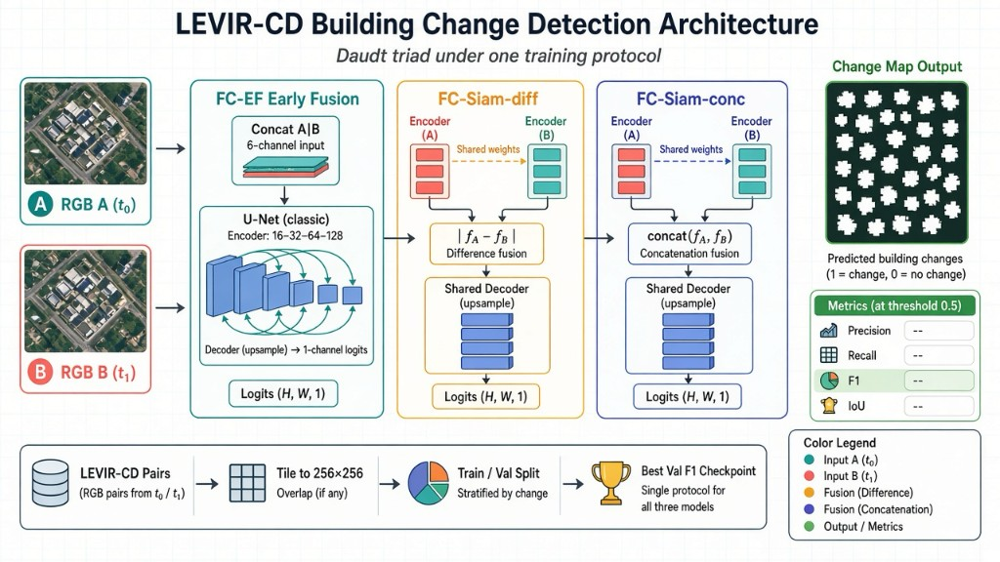
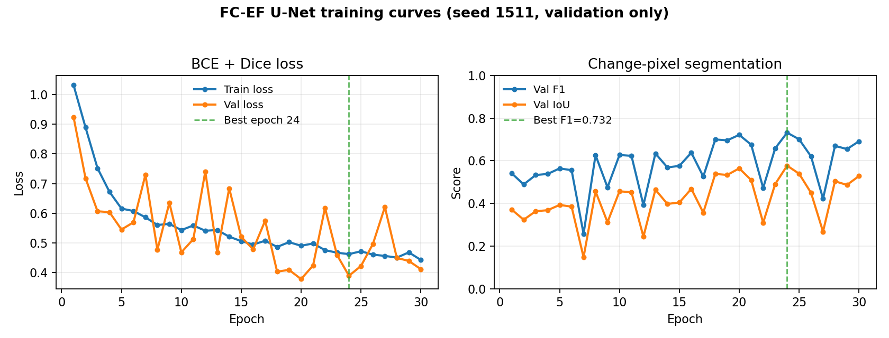
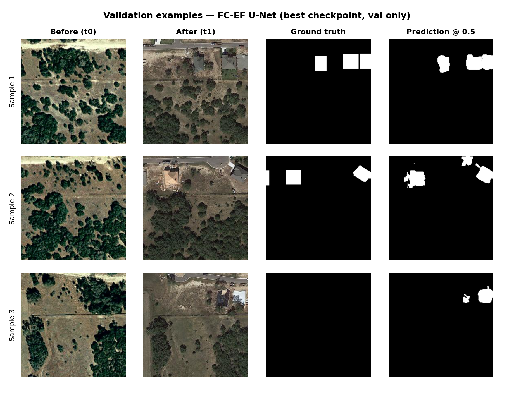

# Deep Learning for Building Change Detection in Multi-Temporal Satellite Imagery

DATA 255 Deep Learning Vision, Fall 2026  
Team **BuildSafe Vision**: Sneha Singh, Ritika Mukesh Neema, Danish Waseem, Rajesh Paruchuri  
Repo: https://github.com/danwaseem/levir-change-detection

**Note on results.** All table numbers below come from finished runs (`results/experiments/`, `results/comparison_table.md`, `results/locked_test/`). We do not invent scores.

---

## Abstract

This project looks at building change detection: given two satellite images of the same location at different times, can a model mark where buildings were added or removed? Plain image subtraction does not work well because lighting, seasons, and vegetation also change. We use the LEVIR-CD dataset and treat the task as binary segmentation.

We compare three networks from Daudt et al. (2018): FC-EF (six-channel U-Net), FC-Siam-diff, and FC-Siam-conc. We also compare BCE vs BCE+Dice and training with vs without paired flips/rotations. For a simple reference, we run absolute RGB difference with a validation-chosen threshold.

On **validation** (GPU full matrix, change-class F1 @ 0.5):

- Absolute difference: F1 = **0.129** (threshold 0.4)
- FC-EF (BCE+Dice, 3 seeds): mean F1 = **0.718**
- FC-Siam-diff (BCE+Dice, 3 seeds): mean F1 = **0.543**
- FC-Siam-conc (BCE+Dice, seed 1511): F1 = **0.773**
- Best setup overall: FC-EF **BCE** (seed 1511), val F1 = **0.778** → locked **test F1 = 0.780**

We are not claiming STANet numbers or published Open-CD / Reality Check scores as ours.

---

## 1. Introduction and research question

The practical need is to find building construction and demolition, not every pixel that looks different between two dates. Shadows, plants, and acquisition conditions create a lot of visual change that is not a building change. So we train a model that outputs a binary change mask.

**Research question.** With the same data splits, tiles, and metrics, does a shared-encoder Siamese U-Net get better building-change F1 than a normal six-channel U-Net? How much do the loss choice and paired augmentation matter, and what is the compute cost?

**Hypotheses.**

- **H1.** FC-Siam-diff should help F1/IoU over FC-EF because the two dates are compared in feature space, though inference may be slower.
- **H2.** BCE+Dice should help more than BCE alone when changed pixels are rare.

We treat success as answering these questions with fair experiments, even if some results are negative or mixed. This is a class research project, not a deployed monitoring product.

---

## 2. Related work

We mainly follow three papers. Longer notes are in [`docs/RELATED_WORK.md`](../docs/RELATED_WORK.md).

1. Ronneberger et al. (2015) proposed U-Net for dense prediction with skip connections [1]. Our FC-EF model is a small U-Net on stacked RGB pairs.

2. Daudt et al. (2018) compared FC-EF, FC-Siam-diff, and FC-Siam-conc for change detection [2]. We coded all three in `models.py` under one training loop. The main comparison in our proposal is FC-EF vs FC-Siam-diff. FC-Siam-conc is included so the full triad is covered.

3. Chen and Shi (2020) released LEVIR-CD and STANet, and used change-class precision, recall, and F1 [3]. We use their dataset and that metric style. We do **not** rebuild STANet attention or their contrastive loss; that was out of scope in the proposal.

Other benchmarks report FC-style models around test F1 0.81–0.86 under longer schedules and wider networks [4,5]. Those papers are useful context. They are not our scores. Our U-Net is narrow (`base=16`).

---

## 3. Dataset and evaluation protocol

### 3.1 Dataset

| Item | Value |
| --- | --- |
| Dataset | LEVIR-CD [3] |
| Link | https://justchenhao.github.io/LEVIR/ |
| Size | 637 RGB pairs, each 1024×1024, about 0.5 m/pixel, Texas scenes |
| Labels | Binary building change masks |
| Use | Academic only; follow Google Earth terms |
| Our copy | Downloaded and checked locally (`../datasets/levir-cd`) |

We keep the official split and cut each image into 16 non-overlapping 256×256 tiles:

| Split | Pairs | Tiles |
| --- | ---: | ---: |
| Train | 445 | 7,120 |
| Val | 64 | 1,024 |
| Test | 128 | 2,048 |

Masks are thresholded at intensity ≥ 128. We only use train/val while picking models. Test is for one final run after we freeze settings.

### 3.2 Split audit

We checked whether any filename stems appear in more than one split (`stem_overlap_report.json`):

| Pair of splits | Overlap count |
| --- | ---: |
| train / val | 0 |
| train / test | 0 |
| val / test | 0 |

No shared stems is good, but it does not prove that nearby geographic areas never leak across splits. That is still a limitation.

### 3.3 Metrics

| Use | Metric |
| --- | --- |
| Main | Change-class F1 (used to pick checkpoints) |
| Extra | IoU, precision, recall, boundary F1, per-image / failure summaries |
| Not for selection | Overall accuracy |
| Threshold | 0.5 for learned models (not tuned on test) |

---

## 4. Methods

### 4.1 Architecture overview

We implement the Daudt triad under one training and metric pipeline. Two dates (A, B) and a building-change mask are tiled to 256×256. The reference path is absolute RGB difference. The learned paths are:

- **FC-EF:** concatenate A and B (6 channels) into one U-Net.
- **FC-Siam-diff:** shared encoder; fuse skip/bottleneck features with `|fA − fB|`.
- **FC-Siam-conc:** shared encoder; fuse by concatenating features.

Every learned model emits a single-channel change map, scored at threshold 0.5 with change-class F1 (plus IoU / precision / recall). Width default is `base=16`. STANet attention is out of scope.



**Figure 1. Architecture overview.** Bi-temporal inputs A/B feed FC-EF, FC-Siam-diff, or FC-Siam-conc, then a change map at threshold 0.5.

### 4.2 Reference baseline

Mean absolute RGB difference `|A − B|`. We pick the threshold on validation by F1. Code: `scripts/run_baseline.py`.

### 4.3 Strong baseline (FC-EF)

Concatenate A and B to 6 channels and run a U-Net with base width 16 (16→32→64→128). About 483k parameters.

### 4.4 Team models (Siamese)

Same encoder weights for A and B. FC-Siam-diff uses `|fA − fB|`. FC-Siam-conc concatenates features. Shared decoder predicts the change map.

### 4.5 Training details

| Setting | Choice |
| --- | --- |
| Loss | BCE or BCE+Dice |
| Optimizer | Adam, lr 1e-3, weight decay 1e-4 |
| Batch size | 4 |
| Epochs | up to 30, early stopping |
| Augmentation | same flip / rot90 on A, B, and mask |
| Checkpoint | best validation F1 |
| Main seeds | 1511, 42, 123 |

---

## 5. Experimental setup

Planned matrix (`scripts/run_plan.py --mode full`):

| Role | Model | Loss | Aug | Seeds |
| --- | --- | --- | --- | --- |
| Main | FC-EF | BCE+Dice | on | 1511, 42, 123 |
| Main | FC-Siam-diff | BCE+Dice | on | 1511, 42, 123 |
| Triad | FC-Siam-conc | BCE+Dice | on | 1511 |
| Loss ablation | FC-EF | BCE | on | 1511 |
| Aug ablation | FC-EF | BCE+Dice | off | 1511 |

Mac MPS was too slow for the nine-run matrix (~16 min/epoch), so full training ran on a university GPU. Smoke tests and unit tests pass on Mac.

---

## 6. Results

### 6.1 Reference baseline vs early FC-EF

| Method | Split | Seed | F1 | IoU | P | R | Params |
| --- | --- | ---: | ---: | ---: | ---: | ---: | ---: |
| Abs RGB difference | val | — | 0.129 | 0.069 | 0.096 | 0.193 | 0 |
| FC-EF U-Net (early baseline) | val | 1511 | 0.732 | 0.577 | 0.691 | 0.778 | 483,169 |

Learned FC-EF is far above raw differencing. Curves and gallery below are from that early baseline run (validation only).





### 6.2 Main comparison (GPU, BCE+Dice, aug on)

| Model | Seed | Val F1 | IoU | P | R | Boundary F1 | Latency (s) |
| --- | ---: | ---: | ---: | ---: | ---: | ---: | ---: |
| FC-EF | 1511 | 0.702 | 0.541 | 0.734 | 0.673 | 0.311 | 0.0015 |
| FC-EF | 42 | 0.727 | 0.571 | 0.707 | 0.749 | 0.323 | 0.0014 |
| FC-EF | 123 | 0.726 | 0.570 | 0.753 | 0.701 | 0.328 | 0.0014 |
| FC-Siam-diff | 1511 | 0.503 | 0.336 | 0.674 | 0.402 | 0.211 | 0.0021 |
| FC-Siam-diff | 42 | 0.606 | 0.435 | 0.608 | 0.604 | 0.227 | 0.0021 |
| FC-Siam-diff | 123 | 0.521 | 0.352 | 0.941 | 0.360 | 0.219 | 0.0021 |
| FC-Siam-conc | 1511 | 0.773 | 0.630 | 0.836 | 0.719 | 0.352 | 0.0028 |

Mean over the three matched seeds (BCE+Dice):

| Model | Mean Val F1 | Spread (std) |
| --- | ---: | ---: |
| FC-EF | 0.718 | 0.011 |
| FC-Siam-diff | 0.543 | 0.045 |

Under the same BCE+Dice protocol, FC-EF beats FC-Siam-diff. Single-seed FC-Siam-conc (0.773) is the strongest BCE+Dice triad run, but overall best validation F1 was FC-EF **BCE** (next section).

### 6.3 Ablations

| Setting | Val F1 | IoU |
| --- | ---: | ---: |
| FC-EF, BCE+Dice, aug on, seed 1511 | 0.702 | 0.541 |
| FC-EF, BCE only, aug on, seed 1511 | **0.778** | 0.636 |
| FC-EF, BCE+Dice, aug off, seed 1511 | 0.745 | 0.594 |

BCE alone beat BCE+Dice on this narrow U-Net. Turning aug off also scored higher than the matched BCE+Dice+aug seed, so paired flips/rotations were not clearly helpful here.

### 6.4 Compute (GPU full runs)

| Model | Params | Train time | Checkpoint size | Batch-1 latency |
| --- | ---: | ---: | ---: | ---: |
| FC-EF (BCE, seed 1511) | 483,169 | ~51 min | ~5.6 MB | 0.0014 s |
| FC-Siam-diff (seed 1511) | 482,737 | ~47 min | ~5.6 MB | 0.0021 s |
| FC-Siam-conc (seed 1511) | 563,889 | ~48 min | ~6.5 MB | 0.0028 s |

### 6.5 Qualitative examples

The gallery above shows three validation tiles for the FC-EF U-Net: hits on larger new buildings (samples 1–2), soft boundaries vs crisp labels, and a false-alarm case (sample 3) where the prediction fires but the ground-truth mask is empty. GPU-run `failure_summary.json` files support the same error themes (small-change misses, empty-tile false alarms).

### 6.6 Locked test

| Item | Value |
| --- | --- |
| Freeze date | 2026-11-08 |
| Chosen setup | FC-EF U-Net, BCE, aug on, seed 1511 (`full_unet_bce_aug_seed1511_tile256`) |
| Test F1 / IoU / P / R | **0.780** / 0.639 / 0.770 / 0.790 |
| Changed model after seeing test? | No |

```bash
PYTHONPATH=src python scripts/run_locked_test.py \
  --checkpoint results/experiments/full_unet_bce_aug_seed1511_tile256/best_model.pt \
  --i-confirm-choices-are-frozen
```

---

## 7. Discussion

Absolute difference is weak (val F1 0.129). Every learned model is far stronger. Under matched BCE+Dice training, FC-EF mean F1 0.718 beats FC-Siam-diff mean 0.543, so shared-encoder difference fusion did **not** win on this narrow (`base=16`) setup. FC-Siam-conc reached 0.773 on one seed, competitive with early-fusion. The loss ablation favored plain BCE (0.778), which we froze for the locked test (test F1 0.780).

Limits: smaller network than many public LEVIR tables, stem check is not a full geo audit, LEVIR is Texas-only, and Siamese-conc has only one seed. We do not claim this system is ready for real monitoring use.

---

## 8. Future work

Beyond this course project, several extensions would strengthen the study:

1. **Capacity and training budget.** Our networks use a small width (`base=16`). A controlled scale-up (wider U-Net / longer schedule) under the same splits would show how much of the gap to published LEVIR F1 numbers is capacity versus architecture choice.
2. **Stronger geographic leakage checks.** Filename stems do not overlap across splits, but nearby scenes could still correlate. Using LEVIR’s released lat/long metadata to measure spatial distance between train and eval tiles would make the protocol tighter.
3. **Other datasets and domains.** Repeating the same FC-EF vs Siamese comparison on WHU-CD or LEVIR-CD+ would test whether the ranking holds outside Texas Google Earth imagery.
4. **Hard cases.** More work on small buildings, dense suburbs, and seasonal / illumination shifts—either with targeted sampling or harder augmentations—would address the failure modes change detectors usually hit.
5. **Efficiency.** Measuring and improving latency (e.g. lighter decoders or export to ONNX) would matter if the method were ever used for large map tiles, though deployment is outside our current claims.
6. **Attention / modern CD models.** Methods such as STANet or transformer-based change detectors are natural follow-ons. We left them out on purpose so the Daudt triad comparison stayed fair and feasible; they remain open for later work.

---

## 9. Conclusion

We built a full LEVIR-CD training and evaluation pipeline with the Daudt triad, a difference baseline, and the planned ablations. On GPU validation, FC-EF (mean F1 0.718) beat FC-Siam-diff (0.543); FC-Siam-conc reached 0.773 on one seed; BCE-only FC-EF was best overall (val 0.778, locked test 0.780). Abs-diff remains at 0.129. Filename stems do not overlap across splits. Claims stay limited to these runs.

---

## 10. Contributions and how to reproduce

| Member | Main work |
| --- | --- |
| Sneha | Dataset checks, stem overlap, abs-diff baseline |
| Ritika | U-Net / FC-EF path, paired aug, seeds |
| Danish | Siamese models, loss comparison, errors |
| Rajesh | Metrics, timing, summaries, reproduction |

Quick code check (no dataset):

```bash
PYTHONPATH=src python scripts/run_smoke.py
PYTHONPATH=src python -m pytest -q
```

Full runs (needs LEVIR; GPU preferred):

```bash
export LEVIR_DATA_ROOT=/path/to/levir-cd
PYTHONPATH=src python scripts/run_plan.py --mode full
PYTHONPATH=src python scripts/run_baseline.py
PYTHONPATH=src python scripts/run_plan.py --aggregate-only
```

---

## 11. Assistance disclosure

*(Team to fill before final submission. List any AI / writing tools used and how claims were checked, or state that no generative AI assistance was used.)*

---

## References

[1] O. Ronneberger, P. Fischer, and T. Brox, “U-Net: Convolutional Networks for Biomedical Image Segmentation,” MICCAI 2015, LNCS 9351, pp. 234–241. doi: 10.1007/978-3-319-24574-4_28.

[2] R. Caye Daudt, B. Le Saux, and A. Boulch, “Fully Convolutional Siamese Networks for Change Detection,” IEEE ICIP 2018, pp. 4063–4067. doi: 10.1109/ICIP.2018.8451652.

[3] H. Chen and Z. Shi, “A Spatial-Temporal Attention-Based Method and a New Dataset for Remote Sensing Image Change Detection,” *Remote Sensing*, 12(10), 1662, 2020. doi: 10.3390/rs12101662. https://justchenhao.github.io/LEVIR/

[4] Open-CD LEVIR-CD benchmark tables (context only). https://github.com/likyoo/open-cd

[5] I. Corley et al., “A Change Detection Reality Check,” arXiv:2402.06994, 2024 (context only).

---

## Appendix

| File | Path |
| --- | --- |
| Proposal | `docs/Data255_ProjectProposal.pdf` |
| Related work notes | `docs/RELATED_WORK.md` |
| Architecture overview figure | `docs/architecture.jpg` |
| Manifest | `results/levir_audit/split_manifest.csv` |
| Stem overlap | `results/levir_audit/stem_overlap_report.json` |
| Abs-diff | `results/absdiff_baseline/summary.json` |
| U-Net baseline | `results/unet_baseline/` |
| GPU comparison table | `results/comparison_table.md` |
| Locked test | `results/locked_test/full_unet_bce_aug_seed1511_tile256/` |
